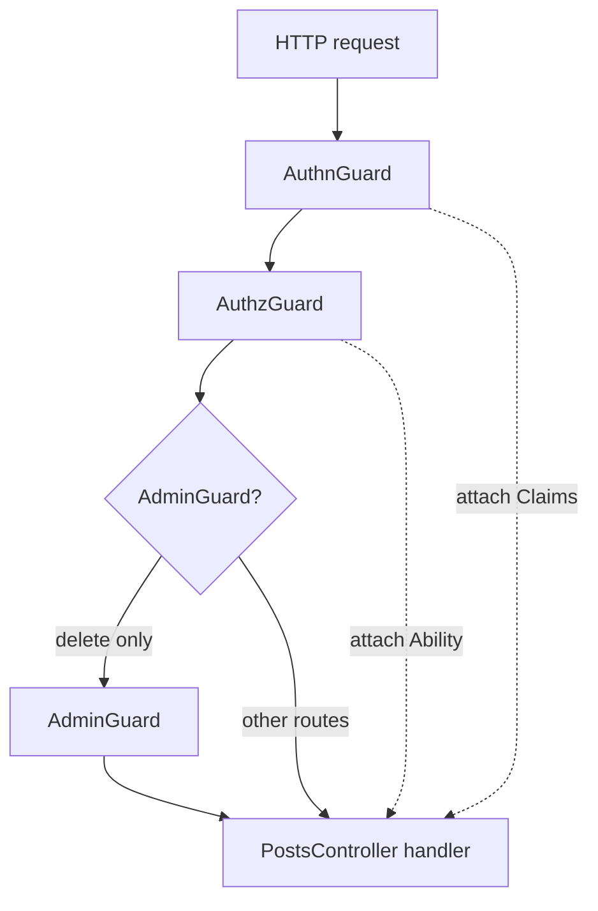
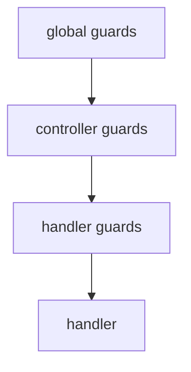
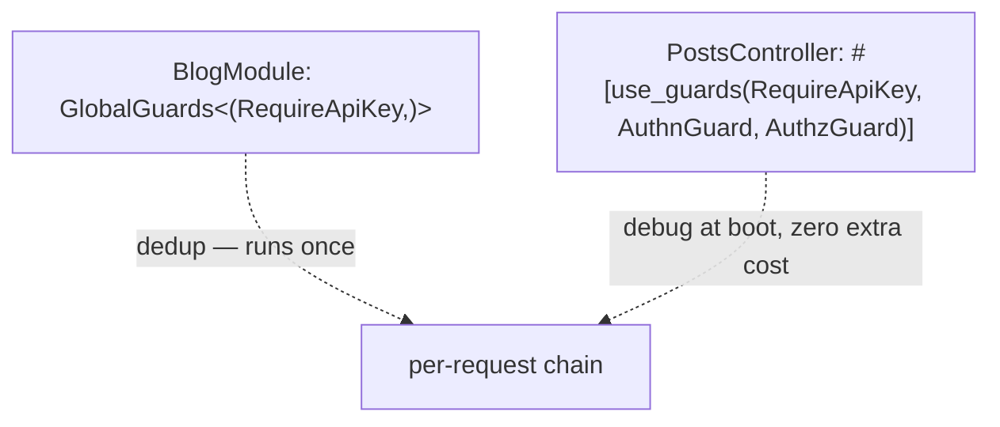

import { Aside } from '@astrojs/starlight/components';

A [guard](/fundamentals/guards/) is written once and bound where it should run:
on a controller for every route it serves, on one route, or in the app's pool
for every route the app mounts. The container resolves each binding from the
same provider, the chain composes outermost first, and a guard bound twice runs
once.

## Secure the post API

After [Modules](/fundamentals/modules/#a-feature-of-its-own), `PostsController`
lives under `posts/http/`. Binding guards on the struct is how you gate
every route on that controller — and declare the auth modules the access
graph must reach.

```rust title="crates/features/src/posts/http/controller.rs"
use std::sync::Arc;
use nest_rs::authz::Read;
use nest_rs::http::{Json, Path, Result, controller, routes};
use nest_rs::seaorm::Authorized;
use uuid::Uuid;

use crate::authn::AuthnGuard;
use crate::authz::AuthzGuard;
use crate::posts::{AdminGuard, Entity as PostEntity, Post, PostsService};

#[controller(path = "/posts")]
#[use_guards(AuthnGuard, AuthzGuard)]
pub struct PostsController {
    #[inject]
    svc: Arc<PostsService>,
}

#[routes]
impl PostsController {
    #[get("/{id}")]
    #[authorize(Read, bind = PostsService)]
    async fn get(&self, post: Authorized<Read, PostEntity>) -> Json<Post> {
        Json(Post::from(&*post))
    }

    #[delete("/{id}")]
    #[use_guards(AdminGuard)]
    async fn delete(&self, id: Path<Uuid>) -> Result<()> {
        self.svc.delete(*id).await
    }
}
```

`AdminGuard` runs *on top of* the controller's two guards. Per-handler
binding is **additive** — it does not replace the controller list.

A route no guard identifying a caller covers does not boot, since silence is not a
decision: the boot refuses every such route not marked `#[public]`, in one error
naming them ([below](#declare-on-the-provider)). Declaring the posture — such a
guard, or `#[public]` — is what makes it intentional, and a rate limit is neither.

The HTTP adapter imports the authz module transitively — same pattern as
`UsersHttpModule` in the repo:

```rust title="crates/features/src/posts/http/module.rs (from the demo, abridged)"
#[module(
    imports = [PostsModule, AuthzModule],
    providers = [PostsController, PostAuditInterceptor],
)]
pub struct PostsHttpModule;
```

```rust title="crates/features/src/authn/module.rs (from the demo)"
#[module(
    imports = [nest_rs::authn::AuthnModule],
    providers = [AuthnStrategy, AuthnGuard],
)]
pub struct AuthnModule;
```

```rust title="crates/features/src/authz/module.rs (from the demo)"
#[module(
    imports = [AuthnModule],
    providers = [AuthzAbility, AuthzGuard],
)]
pub struct AuthzModule;
```

`AuthzGuard` is provided here rather than under `authz/http/` because
`AbilityGuard` answers every transport — its `check_http` attaches the
caller's `Ability`, its `check` refuses a unit no ability reaches, and it
declares `GuardFor` for all four views. A resolver, a gateway and an MCP host
bind the same type, so none of them imports an HTTP adapter to reach it.



Solid arrows are the guard chain on `GET /posts/{id}`. `DELETE` adds
`AdminGuard` on top. `AuthnGuard` attaches `Claims`; `AuthzGuard` builds
the ambient `Ability` the route's class gate and its bound load read.

## The three scopes

A guard binds at one of three scopes. The container resolves all three
from the same provider — declare once, choose *where* it runs.

| Scope | Binding | Resolved by |
|-------|---------|-------------|
| **Global** | `GlobalGuards<(RequireApiKey,)>` in the providers of the module the app boots | The route's guard stage, post-routing (a self-mount's request stage for gateways) |
| **Controller / Resolver / Gateway** | `#[use_guards(AuthnGuard, AuthzGuard)]` on the struct — a resolver binds `AuthzGuard` alone, [authenticated in band](/fundamentals/guards-beyond-http/#a-guard-declares-the-edges-it-checks) | Container, at mount |
| **Per-handler** | `#[use_guards(AdminGuard)]` beside a verb / `#[query]` / `#[subscribe_message]` | Container, at mount |

Multiple guards in one attribute run in **declaration order**, outermost
first — the first listed sees the request before the second.

```rust title="apps/blog/src/module.rs"
use nest_rs::guards::GlobalGuards;
use features::api_key::RequireApiKey;
use nest_rs::core::module;

#[module(
    imports = [/* … */],
    providers = [GlobalGuards<(RequireApiKey,)>],
)]
pub struct BlogModule;
```

The pool lives in the module `main` boots, so `TestApp::builder().module::<BlogModule>()`
boots it too: a suite never re-types it. Only that module declares it — one a
module the app imports lists fails the boot, since a feature would otherwise
choose what covers every route — and once. The pool registers each guard it lists
unless the app already does, so what that guard injects is held to the module's
imports; a guard a feature's module lists stays that module's. The pool resolves
each guard once, at mount, so a guard in it is a singleton: a request-scoped or
transient one fails the boot with `ScopedLayerError`.

Across scopes the chain composes **global → controller → handler**,
outermost first. `Layer::priority` is an optional tiebreaker within one scope
when declaration order cannot express intent — it never moves a guard ahead of
a broader scope's, and most guards leave it at `0`. Listing an authorization
guard before the authentication guard it reads fails the boot, at any scope.



## Where guards run in the chain

Guards are pooled by `TypeId` and execute **once per request**, after routing, in the guard stage — so a global guard still reads `#[public]` route data, and a refusal is answered before any of the route's interceptors or exception filters run. The full family-by-family nesting (guards vs pipes vs interceptors vs exception filters, and why the unit of work wraps the guards) lives on [the request lifecycle](/fundamentals/request-lifecycle/).

## Declare on the provider

A feature's guards go on its provider, so the feature is covered in every app
that imports it:

```rust title="crates/features/src/posts/http/controller.rs (from the demo, abridged)"
#[controller(path = "/posts")]
#[use_guards(AuthnGuard, AuthzGuard)]
// …
pub struct PostsController {
    // …
}
```

A root's pool holds what no host binds: an app-wide guard, an API key or an IP
allow-list, which the deployment decides rather than a feature. The demo's roots
list none, since each controller and gateway binds its own, and
`AuthzGraphqlModule` and `AuthzMcpModule` cover `/graphql` and `/mcp`.

The boot's refusal does not replace a pool. It refuses a route or a gateway message
with no `#[public]` and no guard that identifies or authorizes a caller. An MCP
endpoint whose request runs only guards identifying no one refuses each operation it
carries, tool, prompt or resource, that neither says `#[public]` nor has such a guard
of its own; with no guard at all, one carrying no `#[public]` boots and
[denies every call](/mcp/#the-smallest-possible-tool). The refusal reads the phase a
guard declares, never what the guard checks, so a route under a weaker guard of the
right phase boots.

A pool is how an app makes its own guards run wherever a request meets a guard stage:
every route, a gateway's upgrade, `/graphql` and a gated `/mcp`. That takes in the
`#[public]` routes: `/health/*` are `#[public]`, so a pooled guard that turns anonymous
callers away answers an orchestrator's probes too, unless it
[reads the posture](/fundamentals/guard-context/#attach-context-and-route-metadata). These have no guard stage,
so an API key in the pool does not cover them:

- [the static files](/http/static-files/#limits);
- [the OpenAPI document and UI](/openapi/configuration/#fields);
- a [self-mount declared `Posture::Public`](/extending/transport/#serving-http-from-a-package);
- [a public `/mcp`](/mcp/#the-smallest-possible-tool);
- [what the router answers itself](/fundamentals/request-lifecycle/#what-each-edge-runs),
  a `404` or a `405`.

A guard listed at both sites still runs **exactly once** per request. The Layer
System dedups every layer by
[`TypeId`](https://doc.rust-lang.org/std/any/struct.TypeId.html) across the three
sites: the **broadest site wins**, which also places it in the chain, and narrower
declarations log a `debug` line at boot (deduped once on `nest_rs::layers`) but never
re-execute.

### Re-running one on purpose: `#[force_guards]`

Dedup is what makes redeclaring free, so the one thing it takes away is
running a guard *twice on purpose*. `#[force_guards(...)]` is the opt-out,
and it takes the same list `#[use_guards]` does. It binds the guard on the
method as well, so the guard is not also listed in `#[use_guards]` — the
compiler refuses that second listing:

```rust title="crates/features/src/posts/http/controller.rs"
#[post("/{id}/publish")]
#[force_guards(FreshTokenGuard)]        // replay, even though the pool ran it
#[authorize(Update, bind = PostsService)]
async fn publish(&self, post: Authorized<Update, PostEntity>) -> Result<Json<Post>> { /* ... */ }
```

Reach for it when a guard's answer can go stale between the pool's site and
the handler — a token freshness re-check on a sensitive mutation, a quota
counted per operation rather than per request. Everywhere else it is a second
execution nobody asked for, so the default stays dedup.

**Per operation only.** `#[use_guards]` binds on the struct or the method;
`#[force_guards]` is read only from the method, because re-running a guard is a
decision about one operation rather than a posture a whole controller takes.
Writing it on the struct is a compile error that says so.

**Declare layers on the provider that needs them, not only at the app
boundary.** A `crates/features` controller is designed to be portable — if
it relies only on the app's `GlobalGuards<(...)>` to be secure, a second app
without that declaration could not serve it. The compiler will not complain, but
the boot refuses: with **no guard identifying a caller in the pool**, every route
that binds no such guard itself and is not marked `#[public]` is named in one boot
error, which gives each remedy. Redeclare on `PostsController`
to bind the policy to the code that needs it, or mark genuinely-open
routes `#[public]` on purpose. The same convention serves interceptors
and filters, which have no such refusal.



<Aside type="note" title="What to remember">
- **Guard** — `#[injectable]` provider; `Ok(())` passes, `Denial`
  short-circuits with a typed status.
- **Three scopes** — global, controller, handler; compose outermost-first;
  per-handler is additive.
- **Declare on the provider** — `#[use_guards(...)]` on `PostsController`
  binds security to the feature; global + controller dedup to one run.
- **Order matters** — `AuthnGuard` before `AuthzGuard`; the unit of work
  outside every guard, so a refused mutation opens no transaction.
</Aside>

## Going further

- [Guards](/fundamentals/guards/) — writing a guard, its two entries and what
  its document lists.
- [Guard context](/fundamentals/guard-context/) — what a guard attaches, and the
  route metadata and posture it reads.
- [The request lifecycle](/fundamentals/request-lifecycle/) — where a
  guard sits among the other three layer families.
- [Interceptors](/fundamentals/interceptors/) — the sibling layer: it
  wraps the handler instead of gating it, and dedups the same way.
