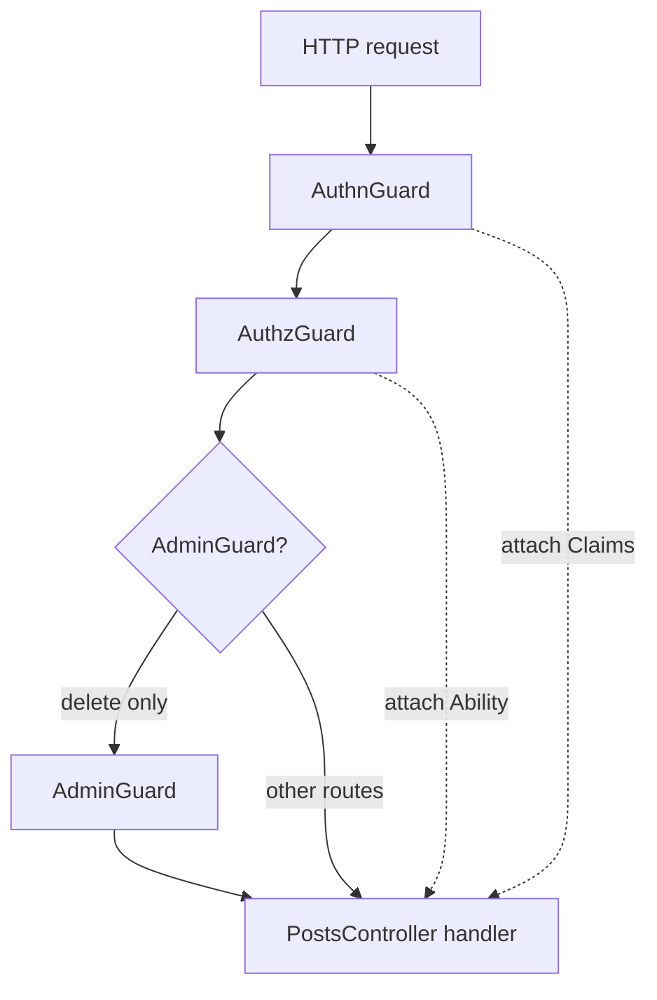
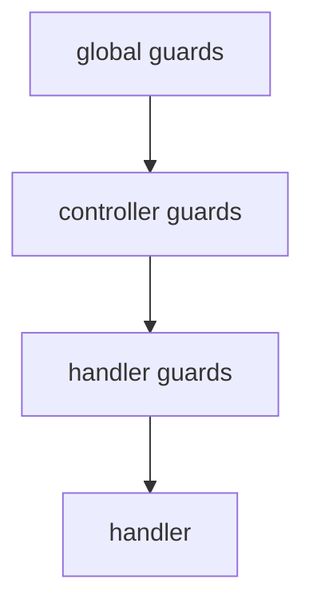
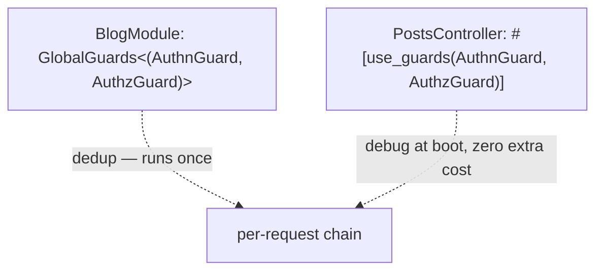

import { Aside } from '@astrojs/starlight/components';

This page continues **`blog`** from
[Modules](/fundamentals/modules/) and
[Providers](/fundamentals/providers/) — the composed stage before you
open the [tutorial](/tutorial/) `posts/` feature. Once `PostsHttpModule` mounts
`PostsController`, guards decide *who* reaches each handler — and often
attach the principal the handler reads back via `Ambient<T>`.

## Install

```bash frame="terminal"
cargo add nest-rs --features guards
```

The `http` feature turns this on, and `http` is a default — name it explicitly only in a headless app built with `default-features = false`, where no transport implies it.

## What a guard does

A guard runs *before* the handler. It sees the request first and either
lets it through (`Ok(())`) or short-circuits with a typed `Denial` the
framework maps to 401 / 403 / 429 — or 503, `Denial::unavailable`, when
something the guard depends on did not answer and the caller did nothing
wrong. A guard writes no log line for its refusals: the edge that ran it files
each denial once, `guard denied …` on the target the guard declares
(`fn target`, `nest_rs::layers` when it declares none) — at `warn`, at `error`
for a `500` — naming the guard as you write it (`AuthnGuard<JwtStrategy<Claims>>`)
and the unit by the fields of its `mounted` line: `host` and `method`, then
`verb` and `path` on a request, `kind` and `field` on a GraphQL operation, `event`
on a WebSocket message, `tool`, `prompt` or `resource` on an MCP operation. It
carries the `reason` the denial names
(`Denial::forbidden("…").with_reason("banned_author")`) and, when the denial
keeps what failed (`.with_source(err)`), the whole chain as its `error` field,
while the caller reads the condition alone. On HTTP the denial is answered as a
problem document, unless the guard's protocol fixes a refusal of its own: a
token endpoint's client is refused in RFC 6749 §5.2's words, which
`ClientAuthenticationGuard` writes through `HttpView::respond` before it
returns its denial, and the edge serves that answer instead
([Token endpoint errors](/security/authentication/oauth2/#token-endpoint-errors)).
One trait, four edges — the same `#[injectable]` impl gates an HTTP route, a
GraphQL field, a WebSocket message and an MCP operation
([Guards beyond HTTP](/fundamentals/guards-beyond-http/)).

`Guard` ships in
[`nest-rs-guards`](https://crates.io/crates/nest-rs-guards). It extends
[`Layer`](https://docs.rs/nest-rs-core/latest/nest_rs_core/trait.Layer.html)
so guards plug into dedup-by-`TypeId` and declaration-order chaining;
`#[derive(Layer)]` writes that impl, with `#[layer(priority = …)]` when the
guard orders itself within its site.

### A minimal custom guard

```rust title="crates/features/src/posts/guard.rs"
use nest_rs::core::{Layer, UnitContext, async_trait, injectable};
use nest_rs::guards::{Denial, Guard, GuardFor};
use nest_rs::http::HttpView;

#[injectable]
#[derive(Layer)]
pub struct RateLimitGuard;

#[async_trait]
impl Guard for RateLimitGuard {
    async fn check(&self, cx: &mut UnitContext<'_>) -> Result<(), Denial> {
        if over_quota(HttpView::of(cx)?.request()) {
            return Err(Denial::rate_limited(60, "rate limited").with_reason("over_quota"));
        }
        Ok(())
    }
}

impl GuardFor<HttpView> for RateLimitGuard {}
```

That last line declares the units your guard checks — see
[A guard declares the edges it checks](/fundamentals/guards-beyond-http/#a-guard-declares-the-edges-it-checks).
Without it, binding this guard on a route is a compile error.

A guard is an `#[injectable]` provider: a module's `providers = [...]` lists it,
unless the [app-wide pool](#the-three-scopes) alone names it and registers it. The
access graph (see
[Providers](/fundamentals/providers/#the-access-graph--wiring-checked-at-boot))
ensures every controller / resolver / gateway that references it imports
a module that builds it.

The trait carries two entries, both over the unit being dispatched, and a
guard writes its decision once: `check` runs on every unit, and `check_http`
runs `check` unless the guard overrides it. `check` has no default, so every
guard writes its decision: `RateLimitGuard` reads the HTTP request in it, and
binds on HTTP alone. Override `check_http` only where the HTTP request differs
from the unit — the guard answers in its protocol's own words, or what is
missing at the request means something else than at the unit. A guard whose
decision is the request's alone admits the units that request carries with an
explicit `Ok(())` in `check`: no guard admits by default.

A guard also says what it does about the caller, through `phase()`:
`GuardPhase::Authentication` establishes who it is, `GuardPhase::Authorization`
decides what it may do, and `GuardPhase::Other`, the default, does neither: a rate
limit, a feature gate. **Only the first two cover a unit.** `RateLimitGuard` above
identifies no one, so a route under it alone says `#[public]`, or the boot refuses
it; a guard of your own that does gate declares its phase.

| Entry | Runs on | Reads it through |
|-------|---------|------------------|
| `check_http` | an HTTP request: a route, a WS upgrade, the `/graphql` and `/mcp` requests; `check` unless overridden | `HttpView::of(cx)` — the request, head and body, and the route it matched |
| `check` | every unit: a GraphQL field, a WS message, an MCP operation — and the request, through `check_http` | `cx.switch_to::<GraphqlView>()`, `WsView`, `McpView` |

```rust title="nest_rs::guards::Guard"
#[async_trait]
pub trait Guard: Layer {
    async fn check_http(&self, cx: &mut UnitContext<'_>) -> Result<(), Denial> { self.check(cx).await }
    async fn check(&self, cx: &mut UnitContext<'_>) -> Result<(), Denial>;
    fn target(&self) -> &'static str { "nest_rs::layers" }
}
```

Whatever the edge, the [execution context](/fundamentals/execution-context/)
answers the same questions: `cx.reflector()` reads what the site declared
(`#[meta]`, its posture), `cx.ambient::<T>()` what an earlier guard attached,
`cx.attach(value)` hands a value to everything after the guard, and
`cx.edge()` and `cx.handler()` say which unit this is.

### A guard that needs an earlier one's work

A value an earlier guard attaches — the principal `AuthnGuard` verified — is a
precondition, not a decision. `cx.require::<Claims>()?` reads it, and a guard
declaring that principal through `expected_principal` writes one decision for every
edge, because its absence answers by cause:

```rust title="crates/features/src/posts/guard.rs (from the demo)"
#[injectable]
#[derive(Layer)]
pub struct PostAuthorGuard;

#[async_trait]
impl Guard for PostAuthorGuard {
    async fn check(&self, cx: &mut UnitContext<'_>) -> Result<(), Denial> {
        let claims = cx.require::<Claims>()?;
        match claims.sub.user_id() {
            Some(_) => Ok(()),
            None => Err(Denial::forbidden("writing a post takes a token naming a user")
                .with_reason("not_a_user")),
        }
    }

    fn phase(&self) -> GuardPhase {
        GuardPhase::Authorization
    }

    fn expected_principal(&self) -> Option<PrincipalClaim> {
        Some(PrincipalClaim::of::<Claims>())
    }

    fn target(&self) -> &'static str {
        crate::posts::TARGET
    }
}

impl<V: UnitView> GuardFor<V> for PostAuthorGuard {}
```

**Nothing in the chain attaches it**, the guard that does declaring
`produced_principal` as `AuthnGuard` does: the boot refuses the route, the field,
the message or the operation, naming the guard and the type, so the wiring gap never
reaches a caller. **The guard attaching it ran and admitted a caller with none** —
`/graphql` lets a visitor through to each field's own gate, a `#[public]` route lets
one in: the caller's `401`, on every edge, and on a `#[public]` route the
`invalid_token` answer a credential it set aside earned, as an `Ambient<T>` parameter
reads it. Any other value's absence stays what it
always was, a `500` the edge files once at `error`, naming the guard and the type.
A guard that does without the principal, and decides a visitor itself, reads it with
`cx.ambient::<T>()` and declares `PrincipalClaim::of::<T>().or_visitor()`.

### What a route's document lists

A route's [OpenAPI document](/openapi/) lists the statuses its guards can
refuse it with — the app's pool, its controller's and its own, the chain the
route runs — whatever each guard is named or aliased. A guard declares them
in `denial_statuses`, read off its `Err` paths; the default is `401` and `403`
on a route that is not `#[public]` and nothing on one that is. The rate limit
above answers neither:

```rust title="crates/features/src/posts/guard.rs"
impl Guard for RateLimitGuard {
    // …
    fn denial_statuses(&self, _public: bool) -> &'static [u16] {
        &[429]
    }
}
```

The framework's guards declare theirs: `AuthnGuard` a `503` on every route
and a `401` off a `#[public]` one, `ClientAuthenticationGuard` a `400`, a
`401` and a `503` on every route, `ThrottlerGuard` a `429`, the ability guard
none — the `403` an ability earns is answered where it is read, and a masked
route lists it. A `500` is never declared: every route lists it.

## Secure the post API

After [Modules](/fundamentals/modules/#extract-a-feature), `PostsController`
lives under `posts/http/`. Binding guards on the struct is how you gate
every route on that controller — and declare the auth modules the access
graph must reach.

```rust title="crates/features/src/posts/http/controller.rs"
use std::sync::Arc;
use nest_rs::authz::Read;
use nest_rs::http::{Json, Path, Result, controller, routes};
use nest_rs::seaorm::Authorized;
use uuid::Uuid;

use crate::authn::AuthnGuard;
use crate::authz::AuthzGuard;
use crate::posts::{AdminGuard, Entity as PostEntity, Post, PostsService};

#[controller(path = "/posts")]
#[use_guards(AuthnGuard, AuthzGuard)]
pub struct PostsController {
    #[inject]
    svc: Arc<PostsService>,
}

#[routes]
impl PostsController {
    #[get("/{id}")]
    #[authorize(Read, bind = PostsService)]
    async fn get(&self, post: Authorized<Read, PostEntity>) -> Json<Post> {
        Json(Post::from(&*post))
    }

    #[delete("/{id}")]
    #[use_guards(AdminGuard)]
    async fn delete(&self, id: Path<Uuid>) -> Result<()> {
        self.svc.delete(*id).await
    }
}
```

`AdminGuard` runs *on top of* the controller's two guards. Per-handler
binding is **additive** — it does not replace the controller list.

A route no guard identifying a caller covers does not boot, since silence is not a
decision: the boot refuses every such route not marked `#[public]`, in one error
naming them ([below](#declare-on-the-provider)). Declaring the posture — such a
guard, or `#[public]` — is what makes it intentional, and a rate limit is neither.

The HTTP adapter imports the authz module transitively — same pattern as
`UsersHttpModule` in the repo:

```rust title="crates/features/src/posts/http/module.rs (from the demo, abridged)"
#[module(
    imports = [PostsModule, AuthzModule],
    providers = [PostsController, PostAuditInterceptor],
)]
pub struct PostsHttpModule;
```

```rust title="crates/features/src/authn/module.rs (from the demo)"
#[module(
    imports = [nest_rs::authn::AuthnModule],
    providers = [AuthnStrategy, AuthnGuard],
)]
pub struct AuthnModule;
```

```rust title="crates/features/src/authz/module.rs (from the demo)"
#[module(
    imports = [AuthnModule],
    providers = [AuthzAbility, AuthzGuard],
)]
pub struct AuthzModule;
```

`AuthzGuard` is provided here rather than under `authz/http/` because
`AbilityGuard` answers every transport — its `check_http` attaches the
caller's `Ability`, its `check` refuses a unit no ability reaches, and it
declares `GuardFor` for all four views. A resolver, a gateway and an MCP host
bind the same type, so none of them imports an HTTP adapter to reach it.



Solid arrows are the guard chain on `GET /posts/{id}`. `DELETE` adds
`AdminGuard` on top. `AuthnGuard` attaches `Claims`; `AuthzGuard` builds
the ambient `Ability` the route's class gate and its bound load read.

## The three scopes

A guard binds at one of three scopes. The container resolves all three
from the same provider — declare once, choose *where* it runs.

| Scope | Binding | Resolved by |
|-------|---------|-------------|
| **Global** | `GlobalGuards<(AuthnGuard,)>` in the providers of the module the app boots | The route's guard stage, post-routing (a self-mount's request stage for gateways) |
| **Controller / Resolver / Gateway** | `#[use_guards(AuthnGuard, AuthzGuard)]` on the struct — a resolver binds `AuthzGuard` alone, [authenticated in band](/fundamentals/guards-beyond-http/#a-guard-declares-the-edges-it-checks) | Container, at mount |
| **Per-handler** | `#[use_guards(AdminGuard)]` beside a verb / `#[query]` / `#[subscribe_message]` | Container, at mount |

Multiple guards in one attribute run in **declaration order**, outermost
first — the first listed sees the request before the second.

```rust title="apps/blog/src/module.rs"
use nest_rs::guards::GlobalGuards;
use features::authn::AuthnGuard;
use features::authz::AuthzGuard;

#[module(
    imports = [/* … */],
    providers = [GlobalGuards<(AuthnGuard, AuthzGuard)>],
)]
pub struct BlogModule;
```

The pool lives in the module `main` boots, so `TestApp::builder().module::<BlogModule>()`
boots it too: a suite never re-types it. Only that module declares it — one a
module the app imports lists fails the boot, since a feature would otherwise
choose what covers every route — and once. The pool registers each guard it lists
unless the app already does, so what that guard injects is held to the module's
imports; a guard a feature's module lists stays that module's. The pool resolves
each guard once, at mount, so a guard in it is a singleton: a request-scoped or
transient one fails the boot with `ScopedLayerError`.

Across scopes the chain composes **global → controller → handler**,
outermost first. `Layer::priority` is an optional tiebreaker within one scope
when declaration order cannot express intent — it never moves a guard ahead of
a broader scope's, and most guards leave it at `0`. Listing an authorization
guard before the authentication guard it reads fails the boot, at any scope.



## Where guards run in the chain

Guards are pooled by `TypeId` and execute **once per request**, after routing, in the guard stage — so a global guard still reads `#[public]` route data, and a refusal is answered before any of the route's interceptors or exception filters run. The full family-by-family nesting (guards vs pipes vs interceptors vs exception filters, and why the unit of work wraps the guards) lives on [the request lifecycle](/fundamentals/request-lifecycle/).

## Attach context and route metadata

Guards often do more than gate — they produce values the handler needs.
Attach on the way in; read with `Ambient<T>`:

```rust title="the guard attaches, the handler reads"
#[derive(Clone)]
pub struct Tenant(pub String);

impl AmbientValue for Tenant {}

#[async_trait]
impl Guard for TenantGuard {
    fn phase(&self) -> GuardPhase {
        GuardPhase::Authentication
    }

    async fn check(&self, cx: &mut UnitContext<'_>) -> Result<(), Denial> {
        let tenant = HttpView::of(cx)?
            .request()
            .header("x-tenant")
            .ok_or_else(|| Denial::unauthorized("a tenant is required"))?
            .to_owned();
        cx.attach(Tenant(tenant));
        Ok(())
    }
}

impl GuardFor<HttpView> for TenantGuard {}

#[get("/me")]
async fn me(&self, tenant: Ambient<Tenant>) -> Json<Post> {
    Json(self.svc.find_by_tenant(&tenant.0).await?)
}
```

What a guard attaches is ambient for the rest of the unit once every guard of
its stage passed: a handler reads it with an `Ambient<T>` parameter
(`nest_rs::core::Ambient`) — a route, a GraphQL operation, a WebSocket message or
an MCP tool alike, the request's guards' value in every unit the request
carries — a guard after it with `cx.ambient::<T>()`, and code the handler
calls with `nest_rs::core::ambient::<T>()`. Its type implements
`AmbientValue` — a principal type too, since `AuthnGuard` attaches it, and a
claims type
[derives it](/security/authentication/jwt/#claims--your-shape-your-business-rules)
with its `PrincipalIdentity` — and `Clone` for `Ambient<T>`. The request is
borrowed through `HttpView::of(cx)` until you let it go, so take what you need
into an owned value before `cx.attach`, as above.

`Ambient<T>` refuses the unit if the value is absent — a `500` on a route, the
opaque internal error elsewhere, the type filed at `error` — since a missing
context means the guard that should have set it never ran. A large value goes in a
newtype holding an `Arc` (`struct Catalog(Arc<Entries>)`), which clones for
the price of a count; the newtype is what implements `AmbientValue`.

`AuthzGuard` reads `Claims` left by `AuthnGuard` to build the ambient
`Ability`. That is why order matters:
`#[use_guards(AuthnGuard, AuthzGuard)]`, not the reverse.

For per-route policy — required roles, rate-limit quotas — `#[meta(...)]`
declares a typed value; `cx.reflector()` reads it inside the guard. Declare it on
the method, or on the controller for every route it serves; the method's
value of a type wins over the controller's:

```rust title="crates/features/src/posts/http/controller.rs"
#[controller(path = "/admin")]
#[use_guards(AuthnGuard, RolesGuard)]
#[meta(Roles(&["admin"]))]
pub struct AdminController;

#[routes]
impl AdminController {
    #[get("/audit")]
    #[meta(Roles(&["admin", "auditor"]))]
    async fn audit(&self) -> &'static str { "ok" }
}
```

The value is built once — when the route mounts, or the first time a layer
reads it — and every request reads that one copy, so it is
`Send + Sync + 'static`, never cloned, and a guard attaching a value of the
same type does not shadow it. A method holds one value of a type, and so does
its controller: a second would be read by nothing, so the compiler refuses it
when each expression names its type (`Roles(..)`), and the boot when one hides
it (`Roles::new(..)`), naming the type and where. Because the global pool runs post-routing in the route's guard stage (above), a
global guard reads `#[meta(...)]` too — the route's declaration is carried
before the chain runs, and it holds `#[public]` below as well.

`#[public]` is declared the same way. The framework does **not** act on it —
each guard decides what "public" means (`AuthnGuard` may authenticate when
a token is present but not reject anonymous callers; `AuthzGuard` may
still apply visitor rules). Marking a route public does not strip its
guards; it tells them to relax.

A guard reads it as a posture. `/graphql` is `Posture::InBand` — each
operation declares its own — so a guard that lets anonymous callers through
admits both:

```rust title="crates/features/src/posts/guard.rs"
use nest_rs::core::{Posture, UnitContext, async_trait};
use nest_rs::guards::{Denial, Guard};

#[async_trait]
impl Guard for ApiKeyGuard {
    fn phase(&self) -> GuardPhase {
        GuardPhase::Authentication
    }

    async fn check_http(&self, cx: &mut UnitContext<'_>) -> Result<(), Denial> {
        if matches!(cx.reflector().posture(), Posture::Public | Posture::InBand) {
            return Ok(());
        }
        // ...standard policy...
    }

    // … and `check`, its decision on each operation the request carries
}
```

## Read the body in a guard

A guard may read the request body when its decision depends on it — a webhook
whose signature *is* its credential. Nothing has read the body before the
guards run, so a guard that refuses has taken none of it; one that reads it
reads under the transport's cap and its gap bound like any extractor
([Request-body size limit](/http/configuration/#request-body-size-limit)), and
sets the bytes back for the handler. This one checks a
[Standard Webhooks](https://www.standardwebhooks.com/) signature with a
constant-time compare and a five-minute replay window:

```rust title="crates/features/src/upstream/guard.rs"
use std::sync::Arc;
use std::time::{SystemTime, UNIX_EPOCH};

use aws_lc_rs::hmac;
use base64::{Engine, engine::general_purpose::STANDARD};
use nest_rs::core::{Layer, UnitContext, async_trait, injectable};
use nest_rs::guards::{Denial, Guard, GuardFor};
use nest_rs::http::{HttpView, current_body_limit};

use crate::upstream::UpstreamConfig;

#[injectable]
#[derive(Layer)]
pub struct WebhookSignature {
    #[inject]
    config: Arc<UpstreamConfig>,
}

#[async_trait]
impl Guard for WebhookSignature {
    async fn check(&self, cx: &mut UnitContext<'_>) -> Result<(), Denial> {
        if self.config.webhook_secret.is_empty() {
            return Err(Denial::internal("no webhook secret is configured"));
        }
        let req = HttpView::of(cx)?.request_mut();
        let (Some(id), Some(sent_at), Some(signatures)) = (
            req.header("webhook-id"),
            req.header("webhook-timestamp").and_then(|t| t.parse::<u64>().ok()),
            req.header("webhook-signature"),
        ) else {
            return Err(Denial::unauthorized("an unsigned webhook"));
        };
        let now = SystemTime::now().duration_since(UNIX_EPOCH).unwrap_or_default().as_secs();
        if now.abs_diff(sent_at) > 5 * 60 {
            return Err(Denial::unauthorized("a webhook outside the replay window"));
        }
        let id = id.to_owned();
        let tags: Vec<Vec<u8>> = signatures
            .split(' ')
            .filter_map(|s| s.strip_prefix("v1,"))
            .filter_map(|s| STANDARD.decode(s).ok())
            .collect();

        let limit = current_body_limit();
        let body = req
            .take_body()
            .into_bytes_limit(limit)
            .await
            .map_err(|error| {
                Denial::unauthorized(format!("an unreadable webhook body: {error}"))
            })?;
        let key = hmac::Key::new(hmac::HMAC_SHA256, self.config.webhook_secret.as_bytes());
        let signed = [id.as_bytes(), b".", sent_at.to_string().as_bytes(), b".", &body].concat();
        if !tags.iter().any(|tag| hmac::verify(&key, &signed, tag).is_ok()) {
            return Err(Denial::unauthorized("a webhook signature that does not verify"));
        }
        req.set_body(body);
        Ok(())
    }

    fn denial_statuses(&self, _public: bool) -> &'static [u16] {
        &[401]
    }
}

impl GuardFor<HttpView> for WebhookSignature {}
```

`hmac::verify` compares in constant time, and the guard fails closed without a
secret: anyone can sign with an empty key. The route binds the guard and
declares itself public to the authentication guard, since the signature stands
in for a token:

```rust title="crates/features/src/upstream/http/controller.rs"
#[post("/webhooks")]
#[use_guards(WebhookSignature)]
#[public]
async fn receive(&self, body: RawBody) -> Result<()> {
    self.svc.receive(&body).await
}
```

A body past the cap answers `413` and one that stops arriving `408`, whatever
the guard made of the failed read; a refusal is the guard's own `401`, logged
at `warn` like any denial, and declared, so the route's document lists it
beside its `#[public]` opening.

## Declare on the provider

The Layer System dedups every layer by
[`TypeId`](https://doc.rust-lang.org/std/any/struct.TypeId.html) across
the three sites. When the same guard is declared at several levels, the
**broadest site wins**; narrower declarations log a `debug` line at boot
(deduped once on `nest_rs::layers`) but never re-execute.

```rust title="apps/blog/src/module.rs"
#[module(
    imports = [/* … */],
    providers = [GlobalGuards<(AuthnGuard, AuthzGuard)>],
)]
pub struct BlogModule;
```

```rust title="crates/features/src/posts/http/controller.rs (from the demo, abridged)"
#[controller(path = "/posts")]
#[use_guards(AuthnGuard, AuthzGuard)]
// …
pub struct PostsController {
    // …
}
```

`AuthnGuard` and `AuthzGuard` run **exactly once** per request, not twice.
The controller's two extra lines cost zero runtime overhead and one `debug`
line at boot.

### Re-running one on purpose: `#[force_guards]`

Dedup is what makes redeclaring free, so the one thing it takes away is
running a guard *twice on purpose*. `#[force_guards(...)]` is the opt-out,
and it takes the same list `#[use_guards]` does. It binds the guard on the
method as well, so the guard is not also listed in `#[use_guards]` — the
compiler refuses that second listing:

```rust title="crates/features/src/posts/http/controller.rs"
#[post("/{id}/publish")]
#[force_guards(FreshTokenGuard)]        // replay, even though the pool ran it
#[authorize(Update, bind = PostsService)]
async fn publish(&self, post: Authorized<Update, PostEntity>) -> Result<Json<Post>> { /* ... */ }
```

Reach for it when a guard's answer can go stale between the pool's site and
the handler — a token freshness re-check on a sensitive mutation, a quota
counted per operation rather than per request. Everywhere else it is a second
execution nobody asked for, so the default stays dedup.

**Per operation only.** `#[use_guards]` binds on the struct or the method;
`#[force_guards]` is read only from the method, because re-running a guard is a
decision about one operation rather than a posture a whole controller takes.
Writing it on the struct is a compile error that says so.

**Declare layers on the provider that needs them, not only at the app
boundary.** A `crates/features` controller is designed to be portable — if
it relies only on the app's `GlobalGuards<(...)>` to be secure, a second app
without that declaration could not serve it. The compiler will not complain, but
the boot refuses: with **no guard identifying a caller in the pool**, every route
that binds no such guard itself and is not marked `#[public]` is named in one boot
error, which gives each remedy. Redeclare on `PostsController`
to bind the policy to the code that needs it, or mark genuinely-open
routes `#[public]` on purpose. The same convention serves interceptors
and filters, which have no such refusal.



<Aside type="note" title="What to remember">
- **Guard** — `#[injectable]` provider; `Ok(())` passes, `Denial`
  short-circuits with a typed status.
- **Three scopes** — global, controller, handler; compose outermost-first;
  per-handler is additive.
- **Declare on the provider** — `#[use_guards(...)]` on `PostsController`
  binds security to the feature; global + controller dedup to one run.
- **Order matters** — `AuthnGuard` before `AuthzGuard`; the unit of work
  outside every guard, so a refused mutation opens no transaction.
</Aside>

## Going further

- [Guards beyond HTTP](/fundamentals/guards-beyond-http/) — the two
  entries on GraphQL, WebSockets and MCP, and the `GuardFor` declaration.
- [Interceptors](/fundamentals/interceptors/) — the sibling layer: it
  wraps the handler instead of gating it, and dedups the same way.
- [The request lifecycle](/fundamentals/request-lifecycle/) — where a
  guard sits among the other three layer families.
- [Security](/security/) — `AuthnGuard`, `AbilityGuard`, and the chain
  they compose into.
