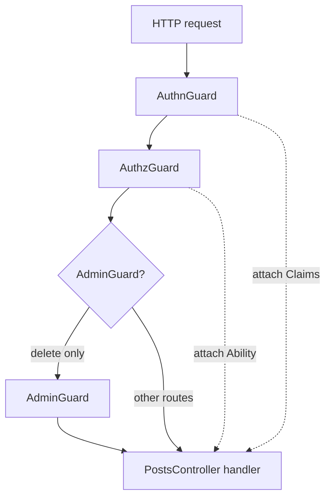
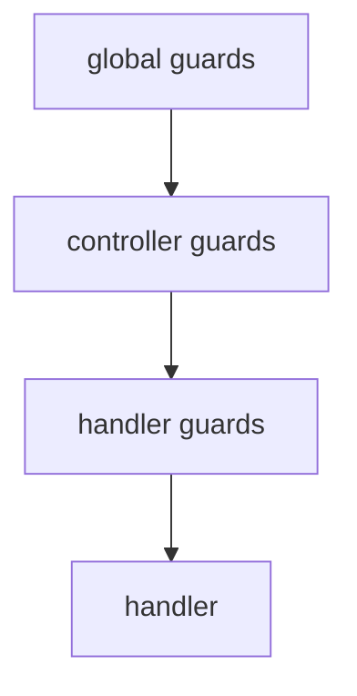
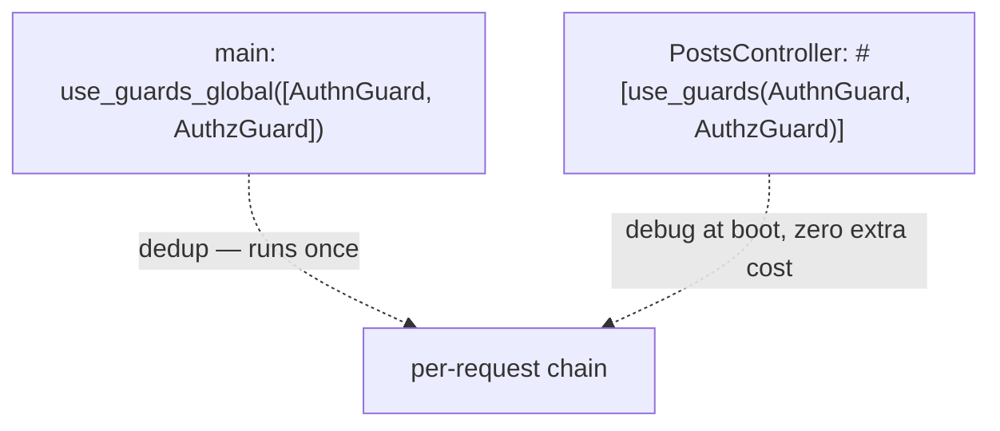

import { Aside } from '@astrojs/starlight/components';

This page continues **`blog`** from
[Modules](/fundamentals/modules/) and
[Providers](/fundamentals/providers/) — the composed stage before you
open the [tutorial](/tutorial/) `posts/` feature. Once `PostsHttpModule` mounts
`PostsController`, guards decide *who* reaches each handler — and often
attach the principal the handler reads back via `Ctx<T>`.

## Install

```bash frame="terminal"
cargo add nest-rs --features guards
```

The `http` feature turns this on, and `http` is a default — name it explicitly only in a headless app built with `default-features = false`, where no transport implies it.

## What a guard does

A guard runs *before* the handler. It sees the request first and either
lets it through (`Ok(())`) or short-circuits with a typed `Denial` the
framework maps to 401 / 403 / 429 — or 503, `Denial::unavailable`, when
something the guard depends on did not answer and the caller did nothing
wrong. `Denial::unavailable_because` keeps what failed as well: every edge
files the denial at `warn`, `guard denied …` on `nest_rs::layers`, and that
line carries the whole chain as its `error` field, while the caller reads the
condition alone. A guard that files a line of its own for every denial — the
framework's authentication, ability and throttler guards do, on their crates'
targets — says so with `files_its_denials()`, and the edge then files none:
one denial is one line, the decider's. One trait, four
transports — the same
`#[injectable]` impl is reachable from HTTP, GraphQL, WS and MCP through the
[the request lifecycle](/fundamentals/request-lifecycle/).

`Guard` ships in
[`nest-rs-guards`](https://crates.io/crates/nest-rs-guards). It extends
[`Layer`](https://docs.rs/nest-rs-core/latest/nest_rs_core/trait.Layer.html)
so guards plug into dedup-by-`TypeId` and declaration-order chaining.

### A minimal custom guard

```rust title="crates/features/src/posts/guard.rs"
use nest_rs::guards::prelude::*;
use nest_rs::http::HttpView;

#[injectable]
#[derive(Default)]
pub struct RateLimitGuard;

impl Layer for RateLimitGuard {}

#[async_trait]
impl Guard for RateLimitGuard {
    async fn check_http(&self, cx: &mut UnitContext<'_>) -> Result<(), Denial> {
        if over_quota(HttpView::of(cx)?.request()) {
            return Err(Denial::rate_limited(60, "rate limited"));
        }
        Ok(())
    }
}

impl GuardFor<HttpView> for RateLimitGuard {}
```

That last line declares the units your guard checks — see
[A guard must declare the transports it checks](#a-guard-must-declare-the-transports-it-checks)
below. Without it, binding this guard on a route is a compile error.

A guard is an `#[injectable]` provider listed in some module's
`providers = [...]`. The access graph (see
[Providers](/fundamentals/providers/#the-access-graph--wiring-checked-at-boot))
ensures every controller / resolver / gateway that references it imports
a module that builds it.

The trait carries two entries, both over the unit being dispatched. One you
do not override admits — that means "doesn't apply here", not "skip
security". Other guards on the same route still run.

| Entry | Runs on | Reads it through |
|-------|---------|------------------|
| `check_http` | an HTTP request: a route, a WS upgrade, the `/graphql` and `/mcp` requests | `HttpView::of(cx)` — the request, head and body, and the route it matched |
| `check` | every other edge's unit: a GraphQL field, a WS message, an MCP operation | `cx.switch_to::<GraphqlView>()`, `WsView`, `McpView` |

```rust title="nest_rs::guards::Guard"
#[async_trait]
pub trait Guard: Layer {
    async fn check_http(&self, cx: &mut UnitContext<'_>) -> Result<(), Denial> { Ok(()) }
    async fn check(&self, cx: &mut UnitContext<'_>) -> Result<(), Denial> { Ok(()) }
}
```

Whatever the edge, the context answers the same questions:
`cx.reflector()` reads what the site declared (`#[meta]`, its posture),
`cx.ambient::<T>()` what an earlier guard attached, `cx.attach(value)` hands
a value to everything after the guard, and `cx.edge()` and `cx.handler()`
say which unit this is. `cx.peer()` names the connection a WebSocket message
came on; the other edges leave it empty. An entry you do not
override costs nothing: it is answered without an allocation.

## Secure the post API

After [Modules](/fundamentals/modules/#extract-a-feature), `PostsController`
lives under `posts/http/`. Binding guards on the struct is how you gate
every route on that controller — and declare the auth modules the access
graph must reach.

```rust title="crates/features/src/posts/http/controller.rs"
use std::sync::Arc;
use nest_rs::authz::Read;
use nest_rs::http::{controller, routes};
use nest_rs::seaorm::Bind;
use nest_rs::http::poem::web::{Json, Path};
use nest_rs::http::poem::Result;
use uuid::Uuid;

use crate::authn::AuthnGuard;
use crate::authz::AuthzGuard;
use crate::posts::{AdminGuard, Post, PostsService};

#[controller(path = "/posts")]
#[use_guards(AuthnGuard, AuthzGuard)]
pub struct PostsController {
    #[inject]
    svc: Arc<PostsService>,
}

#[routes]
impl PostsController {
    #[get("/{id}")]
    async fn get(&self, post: Bind<Read, PostsService>) -> Json<Post> {
        Json(Post::from(&*post))
    }

    #[delete("/{id}")]
    #[use_guards(AdminGuard)]
    async fn delete(&self, id: Path<Uuid>) -> Result<()> {
        self.svc.delete(*id).await
    }
}
```

`AdminGuard` runs *on top of* the controller's two guards. Per-handler
binding is **additive** — it does not replace the controller list.

A route with no guards stays open, but silence is not a decision: the boot
reports every route that binds no guard and is not marked `#[public]` in a
single `warn` naming them ([below](#declare-on-the-provider)). Declaring
the posture — a guard, or `#[public]` — is what makes it intentional.

The HTTP adapter imports the auth bridges transitively — same pattern as
`UsersHttpModule` in the repo:

```rust title="crates/features/src/posts/http/module.rs (from the demo, abridged)"
#[module(
    imports = [PostsModule, AuthzModule],
    providers = [
        PostsController,
        // …
    ],
)]
pub struct PostsHttpModule;
```

```rust title="crates/features/src/authn/module.rs (from the demo)"
#[module(
    imports = [nest_rs::authn::AuthnModule::for_root(None)],
    providers = [AuthnStrategy, AuthnGuard],
)]
pub struct AuthnModule;
```

```rust title="crates/features/src/authz/module.rs (from the demo)"
#[module(
    imports = [AuthnModule],
    providers = [AuthzAbility, AuthzGuard],
)]
pub struct AuthzModule;
```

`AuthzGuard` is provided here rather than under `authz/http/` because
`AbilityGuard` answers every transport — its `check_http` attaches the
caller's `Ability`, its `check` refuses a unit no ability reaches, and it
declares `GuardFor` for all four views. A resolver, a gateway and an MCP host
bind the same type, so none of them imports an HTTP adapter to reach it.



Solid arrows are the guard chain on `GET /posts/{id}`. `DELETE` adds
`AdminGuard` on top. `AuthnGuard` attaches `Claims`; `AuthzGuard` builds
the ambient `Ability` handlers and `Bind` read through.

## The three scopes

A guard binds at one of three scopes. The container resolves all three
from the same provider — declare once, choose *where* it runs.

| Scope | Binding | Resolved by |
|-------|---------|-------------|
| **Global** | `App::builder().use_guards_global([guard::<AuthnGuard>()])` in `main` | Per-route shaper, post-routing (self-mount edge for gateways) |
| **Controller / Resolver / Gateway** | `#[use_guards(AuthnGuard, AuthzGuard)]` on the struct — a resolver binds `AuthzGuard` alone, [authenticated in band](#a-guard-must-declare-the-transports-it-checks) | Container, at mount |
| **Per-handler** | `#[use_guards(AdminGuard)]` beside a verb / `#[query]` / `#[subscribe_message]` | Container, at mount |

Multiple guards in one attribute run in **declaration order**, outermost
first — the first listed sees the request before the second.

```rust title="apps/blog/src/main.rs"
use nest_rs::guards::{AppBuilderGuardsExt, guard};
use features::authn::AuthnGuard;
use features::authz::AuthzGuard;

App::builder()
    .use_guards_global([guard::<AuthnGuard>(), guard::<AuthzGuard>()])
    .module::<BlogModule>()
```

Across scopes the chain composes **global → controller → handler**,
outermost first. `Layer::priority` is an optional tiebreaker within one scope
when declaration order cannot express intent — it never moves a guard ahead of
a broader scope's, and most guards leave it at `0`. Listing an authorization
guard before the authentication guard it reads fails the boot, at any scope.



## Where guards run in the chain

Guards are pooled by `TypeId` and execute **once per request**, post-routing at the `RouteShaper` — so a global guard still reads `#[public]` route data, and a guard denial short-circuits before the route's interceptors run. The full family-by-family nesting (guards vs pipes vs interceptors vs filters, and why `DbContext` wraps the guards) lives on [the request lifecycle](/fundamentals/request-lifecycle/).

## Attach context and route metadata

Guards often do more than gate — they produce values the handler needs.
Attach on the way in; read with `Ctx<T>`:

```rust title="the guard attaches, the handler reads"
#[derive(Clone)]
pub struct Tenant(pub String);

impl AmbientValue for Tenant {}

#[async_trait]
impl Guard for TenantGuard {
    async fn check_http(&self, cx: &mut UnitContext<'_>) -> Result<(), Denial> {
        let tenant = HttpView::of(cx)?
            .request()
            .header("x-tenant")
            .ok_or_else(|| Denial::unauthorized("a tenant is required"))?
            .to_owned();
        cx.attach(Tenant(tenant));
        Ok(())
    }
}

impl GuardFor<HttpView> for TenantGuard {}

#[get("/me")]
async fn me(&self, tenant: Ctx<Tenant>) -> Json<Post> {
    Json(self.svc.find_by_tenant(&tenant.0).await?)
}
```

What a guard attaches is ambient for the rest of the unit once every guard of
its stage passed: the handler reads it with `Ctx<T>`, a guard after it with
`cx.ambient::<T>()`, and a resolver or a tool the request carries with
`nest_rs::core::ambient::<T>()`. Its type implements `AmbientValue` — a
principal type too, since `AuthnGuard` attaches it — and `Clone` for
`Ctx<T>`. The request is borrowed through `HttpView::of(cx)` until you let it
go, so take what you need into an owned value before `cx.attach`, as above.

`Ctx<T>` rejects with 500 if the value is absent — a missing context
means the guard that should have set it never ran. A large value goes in a
newtype holding an `Arc` (`struct Catalog(Arc<Entries>)`), which clones for
the price of a count; the newtype is what implements `AmbientValue`.

`AuthzGuard` reads `Claims` left by `AuthnGuard` to build the ambient
`Ability`. That is why order matters:
`#[use_guards(AuthnGuard, AuthzGuard)]`, not the reverse.

For per-route policy — required roles, rate-limit quotas — `#[meta(...)]`
declares a typed value; `cx.reflector()` reads it inside the guard. Declare it on
the method, or on the controller for every route it serves; the method's
value of a type wins over the controller's:

```rust title="crates/features/src/posts/http/controller.rs"
#[controller(path = "/admin")]
#[use_guards(AuthnGuard, RolesGuard)]
#[meta(Roles(&["admin"]))]
pub struct AdminController;

#[routes]
impl AdminController {
    #[get("/audit")]
    #[meta(Roles(&["admin", "auditor"]))]
    async fn audit(&self) -> &'static str { "ok" }
}
```

The value is built once, the first time a layer reads it, and every request
reads that one copy — so it is `Send + Sync + 'static`, never cloned, and a
guard attaching a value of the same type does not shadow it. Because the global pool runs post-routing at the `RouteShaper` (above), a
global guard reads `#[meta(...)]` too — the route's declaration is carried
before the chain runs, and it holds `#[public]` below as well.

`#[public]` is declared the same way. The framework does **not** act on it —
each guard decides what "public" means (`AuthnGuard` may authenticate when
a token is present but not reject anonymous callers; `AuthzGuard` may
still apply visitor rules). Marking a route public does not strip its
guards; it tells them to relax.

A guard reads it as a posture. `/graphql` is `Posture::InBand` — each
operation declares its own — so a guard that lets anonymous callers through
admits both:

```rust title="crates/features/src/posts/guard.rs"
use nest_rs::guards::prelude::*;

#[async_trait]
impl Guard for ApiKeyGuard {
    async fn check_http(&self, cx: &mut UnitContext<'_>) -> Result<(), Denial> {
        if matches!(cx.reflector().posture(), Posture::Public | Posture::InBand) {
            return Ok(());
        }
        // ...standard policy...
    }
}
```

## Read the body in a guard

A guard may read the request body when its decision depends on it — a webhook
whose signature *is* its credential. Nothing has read the body before the
guards run, so a guard that refuses has taken none of it; one that reads it
reads under the transport's cap and its gap bound like any extractor
([Request-body size limit](/http/configuration/#request-body-size-limit)), and
sets the bytes back for the handler. This one checks a
[Standard Webhooks](https://www.standardwebhooks.com/) signature with a
constant-time compare and a five-minute replay window:

```rust title="crates/features/src/upstream/guard.rs"
use std::sync::Arc;
use std::time::{SystemTime, UNIX_EPOCH};

use aws_lc_rs::hmac;
use base64::{Engine, engine::general_purpose::STANDARD};
use nest_rs::guards::prelude::*;
use nest_rs::http::{HttpView, current_body_limit};

use crate::upstream::UpstreamConfig;

#[injectable]
pub struct WebhookSignature {
    #[inject]
    config: Arc<UpstreamConfig>,
}

impl Layer for WebhookSignature {}

#[async_trait]
impl Guard for WebhookSignature {
    async fn check_http(&self, cx: &mut UnitContext<'_>) -> Result<(), Denial> {
        if self.config.webhook_secret.is_empty() {
            return Err(Denial::internal("no webhook secret is configured"));
        }
        let req = HttpView::of(cx)?.request_mut();
        let (Some(id), Some(sent_at), Some(signatures)) = (
            req.header("webhook-id"),
            req.header("webhook-timestamp").and_then(|t| t.parse::<u64>().ok()),
            req.header("webhook-signature"),
        ) else {
            return Err(Denial::unauthorized("an unsigned webhook"));
        };
        let now = SystemTime::now().duration_since(UNIX_EPOCH).unwrap_or_default().as_secs();
        if now.abs_diff(sent_at) > 5 * 60 {
            return Err(Denial::unauthorized("a webhook outside the replay window"));
        }
        let id = id.to_owned();
        let tags: Vec<Vec<u8>> = signatures
            .split(' ')
            .filter_map(|s| s.strip_prefix("v1,"))
            .filter_map(|s| STANDARD.decode(s).ok())
            .collect();

        let limit = current_body_limit();
        let body = req
            .take_body()
            .into_bytes_limit(limit)
            .await
            .map_err(|error| {
                Denial::unauthorized(format!("an unreadable webhook body: {error}"))
            })?;
        let key = hmac::Key::new(hmac::HMAC_SHA256, self.config.webhook_secret.as_bytes());
        let signed = [id.as_bytes(), b".", sent_at.to_string().as_bytes(), b".", &body].concat();
        if !tags.iter().any(|tag| hmac::verify(&key, &signed, tag).is_ok()) {
            return Err(Denial::unauthorized("a webhook signature that does not verify"));
        }
        req.set_body(body);
        Ok(())
    }
}

impl GuardFor<HttpView> for WebhookSignature {}
```

`hmac::verify` compares in constant time, and the guard fails closed without a
secret: anyone can sign with an empty key. The route binds the guard and
declares itself public to the authentication guard, since the signature stands
in for a token:

```rust title="crates/features/src/upstream/http/controller.rs"
#[post("/webhooks")]
#[use_guards(WebhookSignature)]
#[public]
async fn receive(&self, body: RawBody) -> Result<()> {
    self.svc.receive(&body).await
}
```

A body past the cap answers `413` and one that stops arriving `408`, whatever
the guard made of the failed read; a refusal is the guard's own `401`, logged
at `warn` like any denial.

## Declare on the provider

The Layer System dedups every layer by
[`TypeId`](https://doc.rust-lang.org/std/any/struct.TypeId.html) across
the three sites. When the same guard is declared at several levels, the
**broadest site wins**; narrower declarations log a `debug` line at boot
(deduped once on `nest_rs::layers`) but never re-execute.

```rust title="apps/blog/src/main.rs"
App::builder()
    .use_guards_global([guard::<AuthnGuard>(), guard::<AuthzGuard>()])
    .module::<BlogModule>()
```

```rust title="crates/features/src/posts/http/controller.rs (from the demo, abridged)"
#[controller(path = "/posts")]
#[use_guards(AuthnGuard, AuthzGuard)]
// …
pub struct PostsController {
    // …
}
```

`AuthnGuard` and `AuthzGuard` run **exactly once** per request, not twice.
The controller's two extra lines cost zero runtime overhead and one `debug`
line at boot.

### Re-running one on purpose: `#[force_guards]`

Dedup is what makes redeclaring free, so the one thing it takes away is
running a guard *twice on purpose*. `#[force_guards(...)]` is the opt-out,
and it takes the same list `#[use_guards]` does. It binds the guard on the
method as well, so the guard is not also listed in `#[use_guards]` — the
compiler refuses that second listing:

```rust title="crates/features/src/posts/http/controller.rs"
#[patch("/{id}/publish")]
#[force_guards(FreshTokenGuard)]        // replay, even though the pool ran it
#[authorize(Update, PostEntity)]
async fn publish(&self, post: Bind<Update, PostsService>) -> Result<Json<Post>> { /* ... */ }
```

Reach for it when a guard's answer can go stale between the pool's site and
the handler — a token freshness re-check on a sensitive mutation, a quota
counted per operation rather than per request. Everywhere else it is a second
execution nobody asked for, so the default stays dedup.

**Per operation only.** `#[use_guards]` binds on the struct or the method;
`#[force_guards]` is read only from the method, because re-running a guard is a
decision about one operation rather than a posture a whole controller takes.
Writing it on the struct is a compile error that says so.

**Declare layers on the provider that needs them, not only at the app
boundary.** A `crates/features` controller is designed to be portable — if
it relies only on `use_guards_global([...])` to be secure, forgetting
that line in a second app turns every route public. The compiler will not
complain — but boot now does: with **no global guard pool active**, every
route that binds no controller/method guard and is not marked `#[public]`
is reported in a single `warn` on `nest_rs::layers` (an *implicit* access
decision). The fix is the same either way: redeclare on `PostsController`
to bind the policy to the code that needs it, or mark genuinely-open
routes `#[public]` on purpose. The same rule applies to interceptors and
filters.



## One trait, four transports

A guard overrides the entries that apply to it, and the framework runs each at
its own seam:

| Entry | Runs | Bound by |
|---|---|---|
| `check_http` | post-routing on the request, before the handler; on a WS upgrade; on the `/graphql` and `/mcp` requests | `#[controller]` / `#[routes]`, and the `#[gateway]` struct |
| `check` | per GraphQL field, and in front of the federation root fields | `#[resolver]` / `#[operations]` |
| `check` | once per inbound envelope, after the upgrade | beside a `#[subscribe_message]` |
| `check` | once per `#[tool]` / `#[prompt]` operation, inside rmcp's dispatch | `#[mcp]` host / `#[tools]` operation |

`use_guards_global([...])` reaches every transport at every entry it
implements. `/graphql` and `/mcp` run the pool **in band**: `check_http` once
on their request, `check` once per operation it carries — so a global
`ThrottlerGuard` rate-limits the `/mcp` request and each tool call, and a
global guard overriding only `check` still refuses one.

The three multiplexed transports need one thing on top: a **bridge** above the
resolver, the gateway and the tool, because a unit below the request does not
see the request. The bridge runs the HTTP chain once on it, and what that
chain attached — the caller's `Ability` — is ambient for every operation the
request carries; below it you bind ordinary guards as usual. On `/graphql` and `/mcp` the bridge joins the global pool
rather than replacing it: every pooled guard still runs, and one the bridge
runs itself runs once. That wiring — `AuthzGraphqlModule`, `AuthzWsModule`,
`AuthzMcpModule`, `forward_principal!`, and what each one gates — lives on
[Authorization on GraphQL, WS & MCP](/security/authorization/per-transport-bridges/),
with the connection-vs-message split on
[WebSocket guards](/websockets/guards/).

## A guard must declare the transports it checks

Both entries admit by default — right as "this guard does not apply to that
transport", and the reason a guard bound where it has no check would compile
and pass everything. `GuardFor<V>`, `V` the view of the units a site
dispatches, closes that:

| Bound at | Requires | Because it runs |
|---|---|---|
| `#[controller]` / `#[routes]`, `#[gateway]` struct | `GuardFor<HttpView>` | `check_http` |
| `#[resolver]` / `#[operations]` | `GuardFor<GraphqlView>` | `check` |
| beside a `#[subscribe_message]` | `GuardFor<WsView>` | `check` |
| `#[mcp]` host / `#[tools]` operation | `GuardFor<McpView>` | `check` |

Declare it next to the entry it covers — `impl GuardFor<GraphqlView> for
RequireAdmin {}` — and the binding compiles. Bind a guard that lacks it and it
does not, with a diagnostic naming the view and the way out. `AuthnGuard` is
the guard it catches most often: it checks HTTP requests only, which is why a
resolver binds `AuthzGuard` alone and leaves authentication to the
per-operation bridge. Bound on one anyway:

```text frame="terminal"
$ cargo check -p features
error[E0277]: `nest_rs::nest_rs_authn::AuthnGuard<JwtStrategy<Claims>>` does not declare that it checks `GraphqlView` units
   --> crates/features/src/users/graphql/resolver.rs:14:14
    |
 14 | #[use_guards(AuthnGuard, AuthzGuard)]
    |              ^^^^^^^^^^ bound at a site whose units are `GraphqlView`
    |
    = note: `check_http` and `check` admit by default, so a guard bound here without its check would pass every unit silently
    = note: override `Guard::check_http` (an HTTP request) or `Guard::check` (every other edge's unit), then declare `impl GuardFor<GraphqlView> for nest_rs::nest_rs_authn::AuthnGuard<JwtStrategy<Claims>> {}`
```

The declaration never proves the *entry* is overridden — the default gives
every guard both. It proves you **declared** that this guard checks this
edge's units. An empty `impl Guard for X {}` satisfies the compiler and
passes every request; `GuardFor` is what turns that into an error at the
`#[use_guards]` line rather than a chain entry that guards nothing. A guard
whose one `check` is the same on every edge declares it once for all of them,
`impl<V: UnitView> GuardFor<V> for X {}` — `ThrottlerGuard` does.

A guard bound **globally** takes no `GuardFor`, and that is a deliberate hole
rather than an oversight. A global guard serves whichever edges it
implements — its `check_http` on the request, its `check` on every unit.
Requiring `GuardFor<HttpView>` there would refuse a GraphQL-only guard, and
the alternative is four global lists where the developer wrote one. So an
empty guard registered globally still passes everything: `GuardFor` binds
`#[use_guards]` sites, not the pool.

A guard on the `#[gateway]` **struct** declares `GuardFor<HttpView>`, not
`GuardFor<WsView>` — the upgrade is an HTTP `GET`, and `WsView` belongs to the
per-message scope.

See [Security / per-transport bridges](/security/authorization/per-transport-bridges/)
for the full HTTP / GraphQL / WS wiring, and
[WebSockets / Guards](/websockets/guards/) for the two WS scopes
(connection vs message).

<Aside type="note" title="What to remember">
- **Guard** — `#[injectable]` provider; `Ok(())` passes, `Denial`
  short-circuits with a typed status.
- **Three scopes** — global, controller, handler; compose outermost-first;
  per-handler is additive.
- **Declare on the provider** — `#[use_guards(...)]` on `PostsController`
  binds security to the feature; global + controller dedup to one run.
- **Order matters** — `AuthnGuard` before `AuthzGuard`; global
  interceptors outside global guards (`DbContext` before `AuthzGuard`).
</Aside>

## Going further

- [Interceptors](/fundamentals/interceptors/) — the sibling layer: it
  wraps the handler instead of gating it, and dedups the same way.
- [The request lifecycle](/fundamentals/request-lifecycle/) — where a
  guard sits among the other three layer families.
- [Security](/security/) — `AuthnGuard`, `AbilityGuard`, and the chain
  they compose into.
