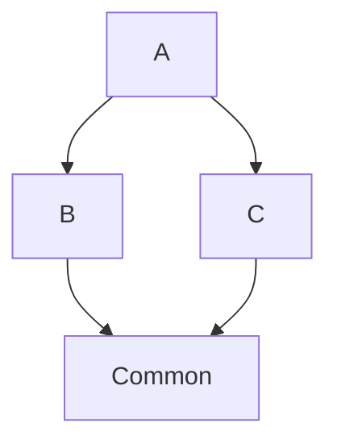

[Modules](/fundamentals/modules/) declare what they own and what they import;
this page is what the boot does with that tree — the phases it runs, which
values every provider reaches and which an import gates, and why a module two
branches import is still built once.

## Boot sequence

`App::builder().build().await` runs four phases, in order:

1. **Seeds** — runtime values from `main` via `.provide(value)`. A seed
   wins over a factory of the same type; a seed of a type a module lists is
   a duplicate the boot refuses — a test replaces a provider with an
   override.
2. **Collect** — every imported module queues the async factories it
   declares (DB pools, …), a dynamic module's from its `collect`.
3. **Factories** — the queue is awaited; outputs land in the container as
   global infrastructure.
4. **Register** — every imported module builds its providers in
   dependency order, its imports first. A provider whose dependency nothing
   had registered yet — across an import cycle, or a type a hand-written
   module registers later — fails the boot naming it and why
   (`UnbuiltProviderError`).

## What is global

What a seed or a factory makes is **app-global**: any provider may inject
it, whichever module queued it. What a module lists in `providers` is
**import-gated**: only that module and the modules importing it, at any
depth, reach it. The framework's global outputs are the infrastructure an app
opens once:

- every `#[config]` a module reads;
- the connections — `DatabaseConnection`, and `RedisConnection` once per
  [instance](/fundamentals/instances/);
- the backend a binding plugs into a port — `dyn UnitOfWork`, the queue's
  `Jobs`, `dyn ThrottlerStore`, `dyn OccurrenceLock` — and the
  `ThrottlerGuard` over its store;
- `JwtService` and `OAuthClient`;
- the kernel's own: `AppLifecycle`, `ReachableProviders`, `ProviderOrder`
  and `Composition`.

A value you seed with `App::builder().provide(value)` joins them. Global is
no licence for data access: a connection is still reached through a service
and `Repo`.

What a hand-written module installs in its own `register` — `EventsModule`'s
`EventBus`, `OpenTelemetryModule`'s `Metrics` — is neither global nor gated:
the access graph does not see it. A provider registered after it reaches it with no import, and
one registered before it fails the boot (`UnbuiltProviderError`, naming the
module), so import the module that installs it and it registers first. In a
module of your own, open app-wide infrastructure in a factory, and list what you gate in
`providers`.

## Safe to import twice

The framework runs each phase of a module once, however many modules
import it, and a module's collect before its register — a module never
reaches another's phases but through an import. A **diamond import** — two
branches that both reach the same module — still builds that module's
providers once:

```rust title="a diamond in the import graph"
#[module(imports = [Common])]
pub struct B;

#[module(imports = [Common])]
pub struct C;

#[module(imports = [B, C])]
pub struct A;
```



`Common`'s providers are registered once, not twice.

The same holds for a framework module you configure. Every controller brings a
bare `HttpModule`, and an app pinning it with
`HttpModule::for_root(...)` still runs one server; `GraphqlModule`, which
every resolver brings, mounts `/graphql` once, and `McpModule`, which
every `#[mcp]` host brings, reads `<PREFIX>_MCP__*` once. What a setup wires per
app — its transport, its mount, the close of what it opened — sits in the
module it imports by type, and an app runs one transport of each type.

What two imports cannot both have is a value each one chose. Two pinned
configs for one module, or two MCP server identities, fail the boot naming
both imports before anything is built — here `BlogModule` pins a port and so
does the `PostsHttpModule` it imports:

```text title="two pins of one config"
contested declaration: `HttpConfig` is declared twice — by `HttpModule::for_root(..)`
at `imports[0]` of `BlogModule`, and by `HttpModule::for_root(..)` at `imports[0]`
of `PostsHttpModule`. A config has one seam — pin it once, on the `for_root` of
the module that owns it, and let every other import of that module stay bare.
```

## Going further

- [Modules](/fundamentals/modules/) — the two lists a module declares, and the
  root that composes them.
- [Providers](/fundamentals/providers/) — the access graph that checks each
  `#[inject]` against the imports.
- [App state](/fundamentals/app-state/) — the sequence `App::run` walks once
  the container is built.
