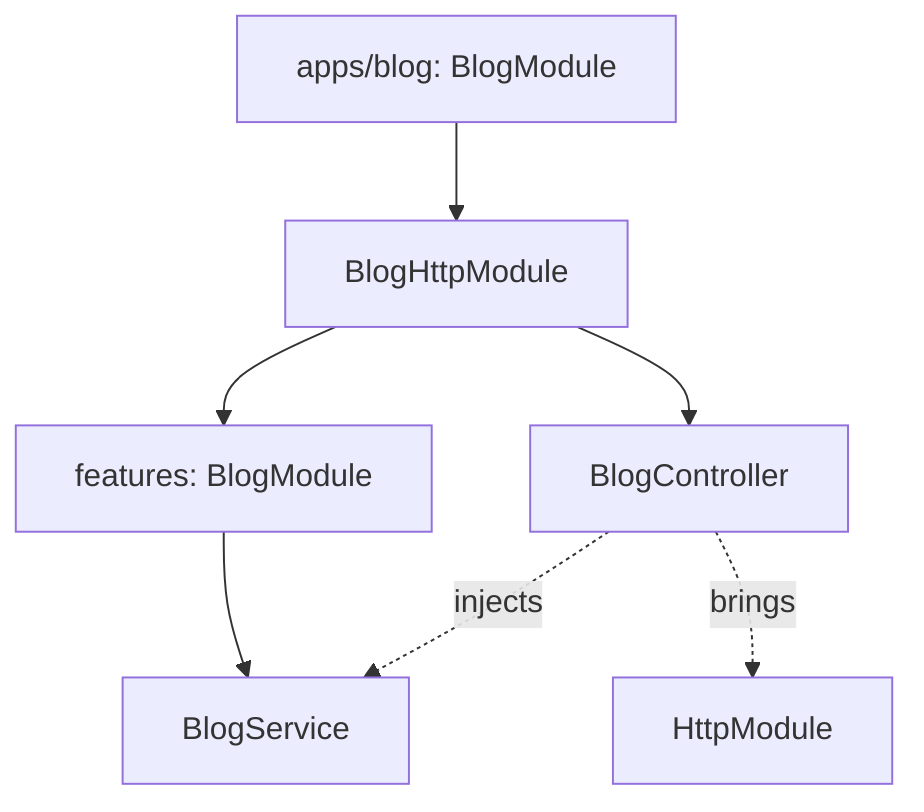
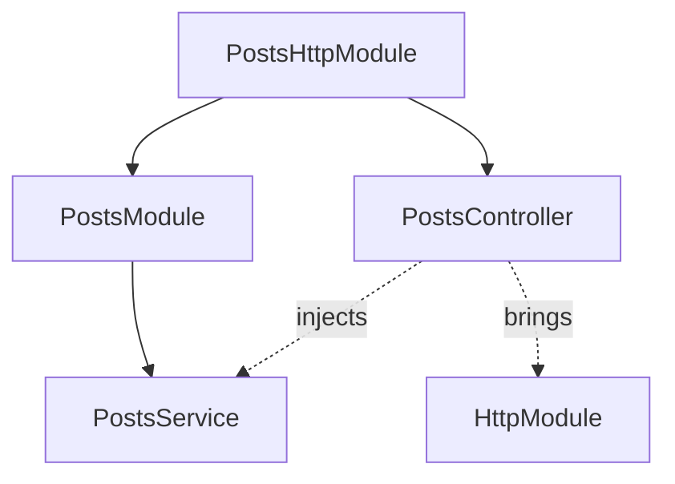
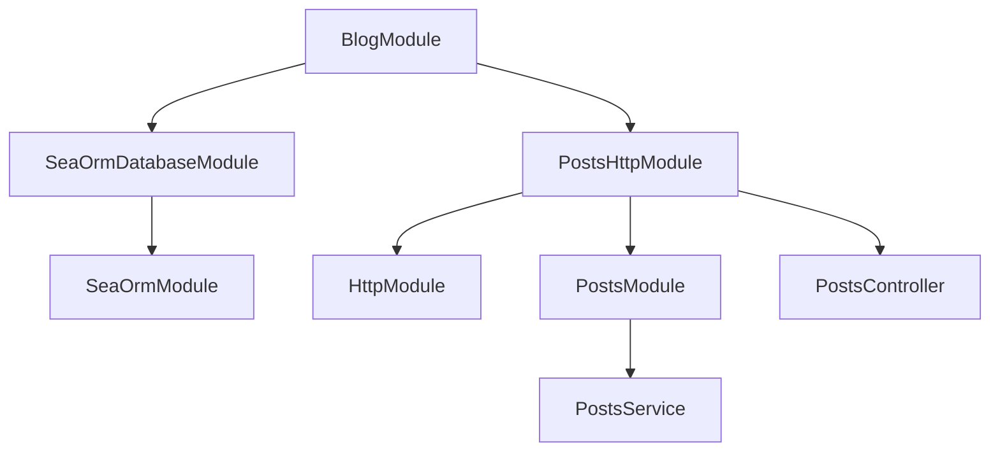

import { Aside, FileTree } from '@astrojs/starlight/components';

Every NestRS binary is a tree of modules. This page walks **`blog`**
through four steps, from what `nestrs new` writes to the composed root the
[tutorial](/tutorial/) implements:

1. **A feature adapter and a root** — the handler in the adapter, the root
   importing it.
2. **A feature of its own** — a domain gets its port and one adapter per edge.
3. **Wire imports** — static vs dynamic framework modules.
4. **Compose** — the root lists imports only; adapters own the handlers.

The snippets are illustrative. Step ① matches the
[Fundamentals](/fundamentals/) tour — the same `BlogModule` grows on the
rest of this page.

## Start with a feature adapter and a root

A module is a struct decorated with `#[module(...)]`. It declares two
things: the **providers it owns** (built and registered into the
container) and the **modules it imports** (whose providers it can
inject).

`nestrs new blog` writes the shape every app keeps. The handler lives in a feature's
adapter, beside the port it serves:

```rust title="crates/features/src/blog/http/module.rs"
use nest_rs::core::module;

use super::controller::BlogController;
use crate::blog::BlogModule;

#[module(imports = [BlogModule], providers = [BlogController])]
pub struct BlogHttpModule;
```

and the app's root imports the adapter, the edge it serves:

```rust title="apps/blog/src/module.rs"
use nest_rs::core::module;

use features::blog::BlogHttpModule;

#[module(imports = [BlogHttpModule])]
pub struct BlogModule;
```

The controller brings `HttpModule`, which starts the server: the decorator already
says the edge. Two modules are named `BlogModule`, the feature's port and the app's
root, and the path says which; the app only ever names the adapter.



## Two lists, one purpose

| List | Holds | Purpose |
|------|-------|---------|
| `providers = [...]` | Injectable structs this module builds — services, controllers, … | Registered into the flat container |
| `imports = [...]` | Other modules — by type or by `Module::for_root(opts)` | Their providers become injectable here |

A provider listed by another module cannot be redeclared — the container
is flat. The access graph (see [Providers](/fundamentals/providers/))
ensures every `#[inject]` resolves through `imports`.

List order does not decide what registers, and a module's providers build in
dependency order. It does order the hooks the graph leaves free, and what a
hand-written module installs reaches only what registers after it
([what is global](/fundamentals/module-boot/#what-is-global)). We still list imports in a
readable order: **infrastructure → the transports it pins → feature
adapters**. The app root imports **`PostsHttpModule`**, not
`PostsModule` — the port rides along inside the adapter's own `imports`.
Business modules sit at the bottom of the list.

## A feature of its own

A real domain gets a feature of its own under `crates/features/src/`, with its
**own name prefix**: `PostsService` and `PostsController` under `PostsModule`,
where `Blog*` was the greeting the scaffold starts from.

<FileTree>
- crates/features/src/posts/
  - module.rs (PostsModule — the port)
  - service.rs (PostsService)
  - entity.rs
  - dto.rs
  - error.rs
  - http/
    - module.rs (PostsHttpModule — imports PostsModule)
    - controller.rs (PostsController)
</FileTree>

One feature, several modules — never one umbrella import. The port
(`PostsModule`) holds the data layer — `PostsService`, entity, repo wiring.
It registers **no** controller, resolver, or gateway. Each transport
adapter (`PostsHttpModule`, …) imports the port and mounts **its** edge only,
and the decorator on its provider brings the transport that edge runs on.

### Why not put the controller in `PostsModule`?

If `PostsController` lived in `PostsModule`, every binary that imported
`PostsModule` would mount HTTP routes — a worker that only enqueues jobs,
another feature that injects `PostsService`, a headless test harness.
Importing the port would always drag the transport with it.

Splitting keeps transport **opt-in per binary**:

| Root imports | What activates |
|--------------|----------------|
| `PostsModule` only | Data layer — `PostsService` injectable, **no HTTP routes** |
| `PostsHttpModule` | HTTP adapter — imports `PostsModule`, mounts `PostsController`, which brings `HttpModule`, and serves it |

`BlogModule` lists `PostsHttpModule`, not `PostsModule`. The adapter
already imports the port; listing both would be redundant. A
`worker` binary would import `PostsModule` (or a queue adapter)
without ever pulling in HTTP.



<Aside type="note">
**One `#[module]` per folder.** A `module.rs` defines exactly one
`#[module]` struct. Multiple modules per feature ⇒ multiple folders. No
`*_module.rs` — the file is always `module.rs`.
</Aside>

## Static and dynamic imports

Framework and feature modules appear in `imports` two ways.

**Dynamic** — a call expression returning a `DynamicModule`, usually
with configuration at the import site:

```rust title="apps/blog/src/module.rs"
HttpModule::for_root(HttpConfig {
    compression: true,
    ..Default::default()
})
```

**Static** — a type, bare or with a type argument naming an instance
(`RedisModule::<Cache>`, below). Feature adapters like `PostsHttpModule`
import this way, and so does every module reading its config from the
environment alone (`SeaOrmModule`):

```rust title="apps/blog/src/module.rs"
PostsHttpModule
```

Static modules dedupe automatically: if two branches of the import tree
both reach `SeaOrmDatabaseModule` (a bare binding, which imports the
`SeaOrmModule` opening its pool), its providers are built once. A dynamic import carries its own config, so each
call is read — but what it wires once per app lives in the module it
imports by type, so it is wired once (see [Safe to import twice](/fundamentals/module-boot/#safe-to-import-twice)).

A dynamic import is the module it configures, as a NestJS `DynamicModule`
names its `module`: importing `StorageModule::for_root(cfg)` reaches what
`StorageModule` provides, exactly as importing `StorageModule` does.

A module an app can open once per [instance](/fundamentals/instances/)
names it as a type argument in a bare import, `BucketModule::<Cache>` beside
the default's bare `BucketModule`, and in the value of a pin,
`BucketModule::for_root((Cache, cfg))` beside the default's `for_root(cfg)`.

<Aside type="tip">
Env vars (`<PREFIX>_<NAMESPACE>__<KEY>`) fill a module's config at boot. A
bare import reads it from the environment alone; `for_root` pins a config,
defaults in code that the real environment can
still override **per field** — never a lock — while the `.env` files no longer
reach that namespace at all, see
[the dual-path rule](/configuration/pinning/#the-dual-path-rule). For the imports above:

```rust title="apps/blog/src/module.rs"
SeaOrmModule
HttpModule
```

```bash title=".env"
NESTRS_SEAORM__URL=postgres://localhost/blog
NESTRS_HTTP__HOST=0.0.0.0
NESTRS_HTTP__PORT=4000
```

Pin values in code when the repo should ship a default; read secrets
and deployment-specific host/port from env. See
[Configuration](/configuration/).
</Aside>

## Compose the root module

Once `blog` needs persistence, the scaffold's greeting gives way to `posts/`, and
the root picks up the backend it chooses. It still lists no provider — it only
composes imports:

```rust title="apps/blog/src/module.rs"
#[module(
    imports = [
        SeaOrmDatabaseModule,
        PostsHttpModule,
    ],
)]
pub struct BlogModule;
```

`PostsHttpModule` imports `PostsModule`, the port, and registers
`PostsController`, which brings `HttpModule`, which starts the transport. The
root lists the adapter and nothing it brings: it never lists the port when it
only wants this transport, never a transport it does not serve, and names
`HttpModule` only to pin its config (`HttpModule::for_root(HttpConfig { .. })`) — same pattern
for every edge.

Each import contributes its providers. HTTP mounts only what the import
tree reaches. Linking a crate without importing its module keeps its
providers **inert** — compiled in, not activated. The boot seals what the
tree reaches into the container; a container built by hand with
`Container::builder()` carries no such set, so a transport asked to discover
from it refuses with `UngatedDiscoveryError`, naming what it discovers, rather
than activating everything linked.

A module listing a controller, a gateway, a resolver, an `#[mcp]`, `#[process]`
or `#[scheduled]` host imports what that edge runs on, bare, because the
decorator on the host says so; a module the app does not reach brings nothing, so
the root's import of the adapter is still the one line opening the edge. A
module listing no host, such as an adapter holding only an interceptor, imports
its transport itself. So does a hand-written module registering a host, or a host
you seed: no `#[module]` lists it, so it brings nothing, and the run names it at
`warn` (`host not served: its edge's transport is not attached`) when nothing
imports what its edge runs on. HTTP, WebSockets and MCP build their own instance
from what the registration attaches, so a seed serves nothing there even beside
the transport, and the run says that instead (`host not served: its edge does not
mount an instance`): list the host in a `#[module]`'s `providers`.

An app run with no transport at all says `app serves nothing: no transport is
attached`, runs its init hooks and stops.

That is the usual shape of a root module: compose features and
framework modules; let adapters own the handlers.



Solid arrows from `BlogModule` are **direct** imports. `PostsModule` and
`HttpModule` are reachable only through `PostsHttpModule` — that is the point.

<Aside type="note" title="What to remember">
- **`#[module]` = two lists** — `providers` you build, `imports` you depend on.
- **Port vs adapter** — data in `PostsModule`, routes in `PostsHttpModule`, whose controller brings the transport it serves on; import the adapter at the root when you want that edge.
- **Opt-in per binary** — import only the modules your deploy serves; everything else stays inert.
</Aside>

## Boot sequence

The boot runs four phases over the import tree — seeds, collect, factories,
register — and reaches what a seed or a factory makes from anywhere, what a module
lists only through an import. [Module boot](/fundamentals/module-boot/) walks
each phase, [what is global](/fundamentals/module-boot/#what-is-global), and why a
module imported twice builds once.

## Going further

- [Fundamentals](/fundamentals/) — minimal `BlogModule`, boot-time access
  graph, breaking wiring on purpose.
- [Providers](/fundamentals/providers/) — injectable types, scopes, the
  access graph in detail.
- [Configuration](/configuration/) — env vars and dynamic modules.
- [HTTP transport](/http/configuration/) — `HttpModule::for_root(...)`
  end to end.
