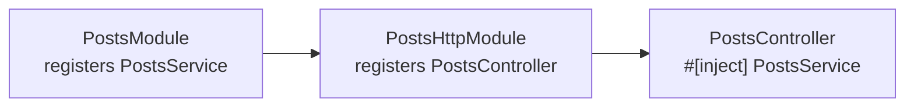
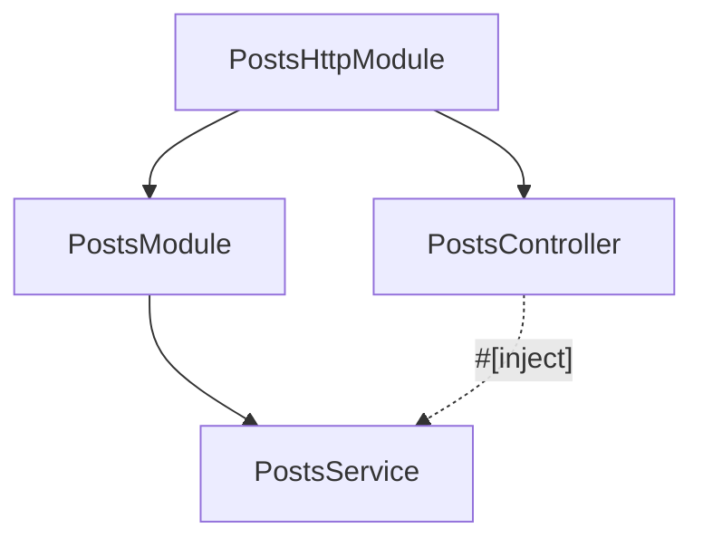
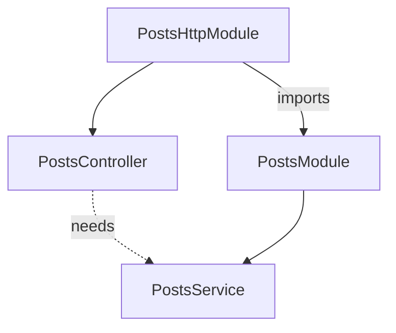

import { Aside } from '@astrojs/starlight/components';

This page continues **`blog`** from
[Modules](/fundamentals/modules/) — step ② onward, before the
[tutorial](/tutorial/) `posts/` layout. Once handlers live in `posts/`, the
container still does the same job: build each provider once (or per
scope), wire `#[inject]` fields, fail at boot if something is unreachable.



## A provider in one glance

A provider is any struct the container can build. Mark it
`#[injectable]`, list it in a module's `providers = [...]`, declare
dependencies as `#[inject]` fields.

```rust title="crates/features/src/posts/service.rs"
use std::sync::Arc;
use nest_rs::core::injectable;
use sea_orm::DatabaseConnection;

#[injectable]
pub struct PostsService {
    #[inject]
    db: Arc<DatabaseConnection>,
}

impl PostsService {
    pub async fn list(&self) -> Vec<Post> { /* ... */ }
}
```

`#[injectable]` registers `PostsService` by `TypeId`. The
`#[inject] db` field says: resolve `Arc<DatabaseConnection>` from the
container when you build me — typically seeded by
`SeaOrmModule::for_root(...)`.

Controllers, resolvers, and gateways are providers too — they just also
mount on a transport:

```rust title="crates/features/src/posts/http/controller.rs"
use std::sync::Arc;
use nest_rs::http::{controller, routes};

#[controller(path = "/posts")]
pub struct PostsController {
    #[inject]
    svc: Arc<PostsService>,
}

#[routes]
impl PostsController {
    #[get("/")]
    async fn list(&self) -> Vec<Post> {
        self.svc.list().await
    }
}
```

```rust title="crates/features/src/posts/module.rs"
#[module(providers = [PostsService])]
pub struct PostsModule;
```

```rust title="crates/features/src/posts/http/module.rs"
#[module(
    imports = [PostsModule],
    providers = [PostsController],
)]
pub struct PostsHttpModule;
```

`PostsModule` owns the service. `PostsHttpModule` owns the controller and
imports the port so `PostsController` can inject `PostsService`.



## What counts as a provider

Anything with a framework struct-level decorator is a provider — built by
the container and listed in `providers = [...]`:

| Decorator | Role in `blog` |
|-----------|----------------|
| `#[injectable]` | `PostsService` — data layer |
| `#[controller]` | `PostsController` — HTTP routes |
| `#[interceptor]` | Cross-cutting HTTP wrapper (logging, DB context, …) |

Other transports use the same idea (`#[resolver]`, `#[gateway]`,
`#[processor]`, …) when you add them. See their categories when you need
them — not required to compose a minimal HTTP app.

Every provider implements `Discoverable`; transports mount only what the
import tree reaches ([Modules](/fundamentals/modules/#compose-the-root-module)).

## Scopes — singleton, request, transient

```rust title="three providers, three scopes"
#[injectable]                    // singleton — default
pub struct PostsService { /* ... */ }

#[injectable(scope = request)]   // one instance per request
pub struct RequestLogger { /* ... */ }

#[injectable(scope = transient)] // fresh instance every resolution
pub struct IdGenerator { /* ... */ }
```

| Scope | Built | Shared as |
|-------|-------|-----------|
| `singleton` (default) | Once at boot | `Arc<T>` everywhere |
| `request` | Once per request | Cached for that request |
| `transient` | On every resolution | Never cached |

A type has **one provider, whatever its scope**. Listing it in two modules, or
registering it once as a singleton and once request-scoped, fails the boot with
a `DuplicateProviderError` naming both registrations and, when they differ,
both scopes.

**Singletons** — `PostsService`, `PostsController`, the DB pool: built at
boot, injected as `Arc<T>`.

**Request-scoped** — may inject singletons; singletons may **not**
inject request-scoped types (they exist before any request). Reach them
through the request boundary, not `#[inject]` on a singleton:

```rust title="crates/features/src/posts/http/controller.rs"
use nest_rs::http::Scoped;

#[get("/trace")]
async fn trace(&self, log: Scoped<RequestLogger>) -> String {
    log.line("listed posts");
    "ok".into()
}
```

HTTP, GraphQL, and MCP each install a fresh request scope per call
(one per request for HTTP, one per operation for GraphQL and MCP).
Within a scope, request-scoped providers are cached and shared; across
scopes, fresh instances are built. GraphQL resolvers reach them with
`nest_rs::graphql::Scoped<T>` (from the async-graphql `&Context`), MCP
tools with `nest_rs::mcp::Scoped<T>` — the same shape as HTTP's
`Scoped<T>`. A request-scoped provider may itself inject another
request-scoped provider (both share the per-request cache); providers
waiting on each other fail the boot, naming the chain (`ProviderCycleError`).

<Aside type="caution">
A `#[dataloader]` batch closure runs **off-task** (a spawned future)
and serves every field of the request, so a request-scoped provider is
not reachable inside batch computation — a batch carries the request's
ambient values instead: its trace, the caller's ability, the pool.
</Aside>

**Transient** — rebuild on every `Scoped<T>` / `get::<T>()` extraction.
Use for throw-away per-call state (a one-shot builder — never a
correlation id, which the framework already carries). A transient that
depends on itself, directly or through others, fails the boot the same way.

<Aside type="note">
Most services in `posts/` are **singletons**. Reach for `request` or
`transient` only when you need per-request or per-call isolation.
</Aside>

## The access graph — wiring checked at boot

The container is flat at runtime — every registered `TypeId` is
globally resolvable — but `#[module]` makes wiring **declarative**. At
boot the access graph checks: every `#[inject]` on a provider must be
reachable from that provider's module through `imports`, or be global
infrastructure (DB pool, config, …).

Typical mistake — controller registered without importing the port:

```rust title="crates/features/src/posts/http/module.rs"
// ✗ PostsModule not in imports — PostsService unreachable here
#[module(providers = [PostsController])]
pub struct PostsHttpModule;
```

```text frame="terminal"
Error: module access violation: `PostsController` (in module
  `PostsHttpModule`) depends on `PostsService`, but `PostsHttpModule`
  imports no module that provides it. `PostsService` is provided by
  `PostsModule` — add `PostsModule` to `#[module(imports = [...])]` of
  `PostsHttpModule`, or route the dependency through a module
  `PostsHttpModule` already imports.
```

The message names the consumer, the missing type, the owning module, and
both fixes — import the owner, or route through a module already imported.
Boot fails before HTTP listens — not on the first request.

The same check applies to layers bound with
`#[use_guards(...)]` / `#[use_filters(...)]` /
`#[use_interceptors(...)]`: if a controller lists a guard, its module
must import a module that provides that guard.



### Optional dependencies

An `Option<Arc<T>>` field is a dependency the provider runs without when this
binary lacks the capability:

```rust title="src/posts/service.rs"
#[injectable]
pub struct PostsService {
    #[inject]
    db: Arc<DatabaseConnection>,
    #[inject]
    notifications: Option<Arc<NotificationsService>>,
}
```

It is `None` when no module the app imports provides `NotificationsService`.
Otherwise the same access graph holds it: when the app imports the module
providing it, `PostsService`'s module imports that module too, or the boot
fails with the access violation above — so whether the capability is present
never depends on the order of `imports`. A singleton cannot hold a
request-scoped or transient provider this way either. And a provider built
before a hand-written module registers what it optionally injects fails the
boot (`LateOptionalDependencyError`) rather than run as if it were absent.

## Hiding the impl — `pub trait` + `as dyn Trait`

When another feature must call into `posts/` without naming the concrete
struct, expose a `pub trait` and keep the impl module-private:

```rust title="crates/features/src/posts/service.rs"
use std::sync::Arc;

use nest_rs::core::{async_trait, injectable};

#[async_trait]
pub trait PostsService: Send + Sync {
    async fn list(&self) -> Result<Vec<Post>, Error>;
}

#[injectable]
pub(crate) struct PostsServiceImpl {
    #[inject]
    db: Arc<DatabaseConnection>,
}

#[async_trait]
impl PostsService for PostsServiceImpl { /* ... */ }
```

```rust title="crates/features/src/posts/module.rs"
#[module(providers = [PostsServiceImpl as dyn PostsService])]
pub struct PostsModule;
```

`#[async_trait]` is required on both the trait and the impl — an async method
in a `dyn`-compatible trait needs the boxed-future desugaring. It comes from
`nest_rs::core`, so this is not a manifest line.

Consumers inject `Arc<dyn PostsService>`, never `PostsServiceImpl`. There
is **no `exports = [...]`** list — Rust visibility plus the
`as dyn Trait` binding is the encapsulation primitive.

The binding builds **one** `PostsServiceImpl` and holds it under its own type
and under each trait it is listed with, so `[Impl as dyn A, Impl as dyn B]` is
one instance. Its `#[hooks]`, `#[scheduled]` and `#[listeners]` methods run on
the instance every `Arc<dyn PostsService>` consumer holds. Listing
`PostsServiceImpl` bare beside its binding is a compile error: the binding
already holds it.

Only a singleton can be bound. Every consumer of `Arc<dyn Trait>` shares the
instance built at boot, so binding anything else is a compile error: an edge
host (`#[controller]`, `#[gateway]`, `#[resolver]`, `#[mcp]`) is built at
mount, a `scope = request` provider once per request, and a
`scope = transient` provider on every resolution. Bind a plain `#[injectable]`
singleton, and reach a scoped provider through the edge's `Scoped<T>`.

When you do not need to hide the impl, register `PostsService` directly
in `PostsModule` — as in the snippets above. The trait pattern is optional:
use it when a second feature needs the port without coupling to your
concrete type.

## The runtime escape hatch

```rust title="apps/api/src/main.rs"
let svc: Arc<PostsService> = container.get::<PostsService>().unwrap();
```

`Container::get` / `get_dyn` resolve imperatively and **bypass the access
graph**. Fine for tests and rare bootstrap glue; in application code,
prefer `#[inject]` so refactors stay checked at boot.

<Aside type="note" title="What to remember">
- **Provider** — `#[injectable]` (or transport decorator) + listed in
  `providers = [...]`.
- **`#[inject]`** — declares a dependency; the access graph proves it is
  reachable through `imports`.
- **Port owns the service, adapter owns the controller** — `PostsModule` +
  `PostsHttpModule`, same as on the Modules page.
</Aside>

## Instances — one resource opened twice

A provider is found by its type, so one type is one value. When an app needs
two of one resource — a queue's Valkey, which must never evict, beside a cache's,
which lives by evicting — each instance is a type of its own: a marker you
declare with `#[instance]`.

```rust title="crates/features/src/catalog/cache.rs"
use nest_rs::core::instance;

#[instance]
pub struct Cache;
```

The marker's name is its ident in snake case — `Cache` reads `cache`, read and
never chosen — and the default instance, `Unnamed`, is the one an app gets
without naming any. A module that can be opened once per instance takes the
marker in its `for_root` value: `x` for the default, `(Cache, x)` for the named
one. Its config then reads `<PREFIX>_<VENDOR>__CACHE__*` (the vendor first,
then the instance), and its resource is injected as `Arc<Resource<Cache>>`
beside the default's `Arc<Resource>` — Redis is one:
`RedisModule::for_root((Cache, None))` opens
[a second Valkey](/queue/topologies/#a-second-valkey), injected as
`Arc<RedisConnection<Cache>>`. Each instance pins its config once; two
instances never contest. A module generic over the instance is written by
hand (`impl<I: Instance> Module for …`), since `#[module]` is not generic:
`ForInstance` in `nest_rs::config` shows one whole.

A value your app builds itself is told apart the same way, by a type. Two
clients of one library are two newtypes — `pub struct
UpstreamClient(reqwest::Client);` — each naming what it reaches. Where the
value must keep its own type, seed it under a marker,
`App::builder().provide(Instanced::<Upstream, _>::from(client))`, and inject
`Arc<Instanced<Upstream, reqwest::Client>>`. `#[inject]` takes no key: a
dependency is found by its type alone.

A module takes an instance only for a **resource an app opens more than
once**, never a database:
`Repo` holds one connection per binary, and a second database is a second
project. An open, extensible set discovered at runtime — a plugin registry,
the social-login providers — is the opposite case: its members are not known
in advance and each carries real code, so it uses the inventory-discovery seam
(a public trait + `inventory::submit!`); see
[social login](/security/authentication/social-login/) for the canonical
example.

## Going further

- [Modules](/fundamentals/modules/) — where providers are listed and
  imports compose.
- [Guards](/fundamentals/guards/) — providers bound at the request edge.
- [Database / `Repo`](/database/) — the choke point every service reaches
  the DB through.
