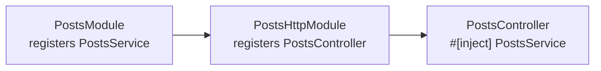
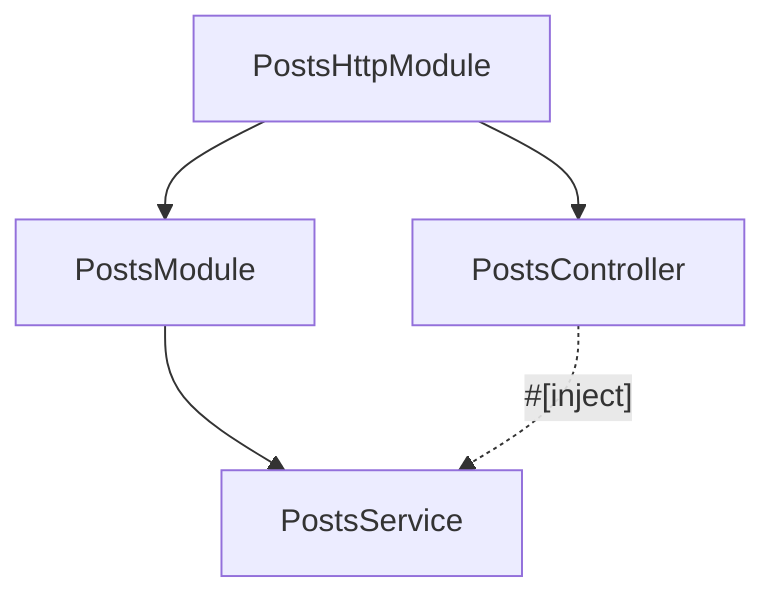
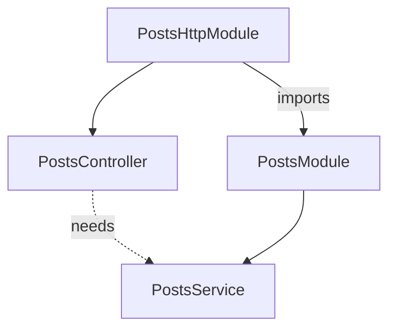

import { Aside } from '@astrojs/starlight/components';

This page continues **`blog`** from
[Modules](/fundamentals/modules/) — step ② onward, before the
[tutorial](/tutorial/) `posts/` layout. Once handlers live in `posts/`, the
container still does the same job: build each provider once (or per
scope), wire `#[inject]` fields, fail at boot if something is unreachable.



## A provider in one glance

A provider is any struct the container can build. Mark it
`#[injectable]`, list it in a module's `providers = [...]`, declare
dependencies as `#[inject]` fields.

```rust title="crates/features/src/posts/service.rs"
use std::sync::Arc;
use nest_rs::core::injectable;

#[injectable]
pub struct PostsService {
    #[inject]
    config: Arc<PostsConfig>,
}

impl PostsService {
    pub async fn list(&self) -> Vec<Post> { /* ... */ }
}
```

`#[injectable]` registers `PostsService` by `TypeId`. The
`#[inject] config` field says: resolve `Arc<PostsConfig>` from the container when
you build me — a `#[config]` a provider injects loads itself. The database is no
field: a service reaches it through `Repo`.

Controllers, resolvers, and gateways are providers too — they just also
mount on a transport:

```rust title="crates/features/src/posts/http/controller.rs"
use std::sync::Arc;
use nest_rs::http::{controller, routes};
use nest_rs::http::Json;

#[controller(path = "/posts")]
pub struct PostsController {
    #[inject]
    svc: Arc<PostsService>,
}

#[routes]
impl PostsController {
    #[get("/")]
    async fn list(&self) -> Json<Vec<Post>> {
        Json(self.svc.list().await)
    }
}
```

```rust title="crates/features/src/posts/module.rs"
#[module(providers = [PostsService])]
pub struct PostsModule;
```

```rust title="crates/features/src/posts/http/module.rs"
#[module(
    imports = [PostsModule],
    providers = [PostsController],
)]
pub struct PostsHttpModule;
```

`PostsModule` owns the service. `PostsHttpModule` owns the controller and
imports the port so `PostsController` can inject `PostsService`. The controller
brings `HttpModule`, the server it is served on.



## What counts as a provider

Anything with a framework struct-level decorator is a provider — built by
the container and listed in `providers = [...]`:

| Decorator | Role in `blog` |
|-----------|----------------|
| `#[injectable]` | `PostsService` — data layer |
| `#[controller]` | `PostsController` — HTTP routes |
| `#[interceptor(stage = unit)]` | What a module brings around every unit's guards (timing, a challenge, …) |

Other transports use the same idea (`#[resolver]`, `#[gateway]`, `#[mcp]`) when
you add them; a queue processor is an `#[injectable]` with a `#[processor]` impl.
See their categories when you need them — not required to compose a minimal HTTP app.

Every provider implements `Discoverable`; transports mount only what the
import tree reaches ([Modules](/fundamentals/modules/#compose-the-root-module)).

## Scopes

A provider is a singleton unless it declares otherwise:
`#[injectable(scope = request)]` builds one per request, `scope = transient` one
per resolution, and a handler reaches either through a `Scoped<T>` parameter.
[Provider scopes](/fundamentals/provider-scopes/) is when each is built and what
shares it.

## The access graph — wiring checked at boot

The container is flat at runtime — every registered `TypeId` is
globally resolvable — but `#[module]` makes wiring **declarative**. At
boot the access graph checks: every `#[inject]` on a provider must be
reachable from that provider's module through `imports`, or be global
infrastructure — what a seed or a factory makes, such as a config or the
database connection ([what is global](/fundamentals/module-boot/#what-is-global)).
What a hand-written module installs in its `register` is outside the check
and reached only once that module has registered: import it.

Typical mistake — controller registered without importing the port:

```rust title="crates/features/src/posts/http/module.rs"
// ✗ PostsModule not in imports — PostsService unreachable here
#[module(providers = [PostsController])]
pub struct PostsHttpModule;
```

```text frame="terminal"
Error: module access violation: `PostsController` (in module
  `PostsHttpModule`) depends on `PostsService`, but `PostsHttpModule`
  imports no module that provides it. `PostsService` is provided by
  `PostsModule` — add `PostsModule` to `#[module(imports = [...])]` of
  `PostsHttpModule`, or route the dependency through a module
  `PostsHttpModule` already imports.
```

The message names the consumer, the missing type, the owning module, and
both fixes — import the owner, or route through a module already imported.
Boot fails before HTTP listens — not on the first request.

The same check applies to layers bound with
`#[use_guards(...)]` / `#[use_exception_filters(...)]` /
`#[use_interceptors(...)]`: if a controller lists a guard, its module
must import a module that provides that guard.



### A dependency nothing provides

A dependency no module of the app provides fails the boot with a
`MissingDependencyError` naming it.

When the crate owning a missing dependency's type knows the line to add, the
refusal says it in place of the generic one. A service injecting
`Arc<Jobs>` in an app that binds no queue backend reads:

```text frame="terminal"
unmet dependency: `PostsService` (in module `PostsModule`) depends on `Jobs`, which no module this app imports provides. Import exactly one queue backend's binding — `nest_rs::redis::RedisQueueModule` binds the queue port over Redis.
```

A crate of your own names one for a type it owns with
`nest_rs::core::DependencyRemedy`, keyed by the type the container holds. The
same line closes the refusal when only a module your app does not reach lists the
type; a module it reaches is named instead, since importing it is the fix.

A type whose key your app chooses — a resource opened [per instance](/fundamentals/instances/),
`RedisConnection<Cache>` — carries its line itself, and the boot reads it where
you inject it, an `#[inject]` field or a `Scoped<T>` parameter alike:

```text frame="terminal"
unmet dependency: `CacheService` (in module `CatalogModule`) depends on `RedisConnection<Cache>`, which no module this app imports provides. Import `nest_rs::redis::RedisModule::<Cache>`, which opens the Redis connection every binding of the `cache` instance shares.
```

A resource of your own that an app opens per instance implements
`nest_rs::core::CarriesRemedy` the same way, its sentence naming the instance's
import.

### Optional dependencies

An `Option<Arc<T>>` field is a dependency the provider runs without when this
binary lacks the capability:

```rust title="crates/features/src/posts/service.rs"
#[injectable]
pub struct PostsService {
    #[inject]
    config: Arc<PostsConfig>,
    #[inject]
    notifications: Option<Arc<NotificationsService>>,
}
```

It is `None` when no module the app imports provides `NotificationsService`.
Otherwise the same access graph holds it: when the app imports the module
providing it, `PostsService`'s module imports that module too, or the boot
fails with the access violation above — so whether the capability is present
never depends on the order of `imports`. A singleton cannot hold a
request-scoped or transient provider this way either. And a provider built
before a hand-written module registers what it optionally injects fails the
boot (`LateOptionalDependencyError`) rather than run as if it were absent.

## Hiding the impl — `pub trait` + `as dyn Trait`

When another feature must call into `posts/` without naming the concrete
struct, bind it behind a trait — `PostsServiceImpl as dyn PostsService` — and
consumers inject `Arc<dyn PostsService>`. [Providers behind a
trait](/fundamentals/provider-traits/) shows the binding and the one instance it
holds.

## The runtime escape hatch

```rust title="apps/api/src/main.rs"
let svc: Arc<PostsService> = container.get::<PostsService>().unwrap();
```

`Container::get` / `get_dyn` resolve imperatively and **bypass the access
graph**. Fine for tests and rare bootstrap glue; in application code,
prefer `#[inject]` so refactors stay checked at boot.

<Aside type="note" title="What to remember">
- **Provider** — `#[injectable]` (or transport decorator) + listed in
  `providers = [...]`.
- **`#[inject]`** — declares a dependency; the access graph proves it is
  reachable through `imports`.
- **Port owns the service, adapter owns the controller** — `PostsModule` +
  `PostsHttpModule`, same as on the Modules page.
</Aside>

## Instances — one resource opened twice

A provider is found by its type, so one type is one value. Two of one resource —
a queue's Valkey beside a cache's — are two types: a marker declared with
`#[instance]`, which [Instances](/fundamentals/instances/) walks through.

## Going further

- [Modules](/fundamentals/modules/) — where providers are listed and
  imports compose.
- [Provider scopes](/fundamentals/provider-scopes/) — singleton, request or
  transient, and the `Scoped<T>` parameter.
- [Guards](/fundamentals/guards/) — providers bound at the request edge.
- [Database / `Repo`](/database/) — the choke point every service reaches
  the DB through.
